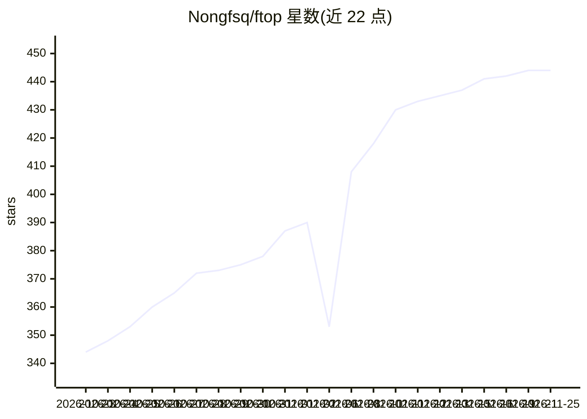

# Nongfsq/ftop

⭐ 444 · Swift · MIT · 推送 2026-11-14 · [GitHub](https://github.com/Nongfsq/ftop) · [官网](https://github.com/Nongfsq/ftop/releases/latest) · 个人维护 · 中文 README

**Apple Silicon Mac 的浮动玻璃面板系统监视器**

面向 Apple Silicon Mac 的原生窗口系统监视器：以一块可任意缩放的浮动面板替代常驻终端监控，展示每核 CPU、内存压力、网络速率、GPU 使用与频率、整机功耗、温度及最繁忙进程（含进程卡片与结束进程操作）。布局随窗口大小自适应；支持菜单栏显示 1-3 项读数、JSON5 配置文件、每日自动更新、登录自启，以及通过 sudo 授予的辅助工具查看系统进程。要求 macOS 15+，仅支持 Apple Silicon。

## 筛选速览

| 维度 | 判定 | 备注 |
|---|---|---|
| AI 角色 | `ai-enhanced` | 去掉 AI 部分产品仍成立 |
| 许可风险 | `permissive` | MIT |
| 部署形态 | `desktop` | 安装包/桌面程序 |
| 模型依赖 | — | README 未给出锁定关系 |
| 硬件要求 | — | 无带数字的原话,不猜 |
| 安装摩擦 | `low` | 无编译、无系统依赖或容器化 |
| 成熟度 | — | 结构信号不足 |

## 能力要点

- 单面板自适应任意窗口尺寸，布局随大小切换
- 每核 CPU 频率与温度读数（经 IOReport/HID 私有接口）
- 菜单栏可同时显示 CPU/内存/GPU 等 1-3 项读数
- 隐藏或被遮挡时近乎停止读取以降低开销

## 适用场景

- 本地跑大模型或编译时一眼看清各核、GPU 与内存占用
- 找出占用 CPU 的具体应用并直接结束其进程
- 在菜单栏常驻监视 GPU 或功耗读数

## 场景标签

 · 领域:系统工具/系统监控

## 证据(README 行号)

> L3:  A small, quiet system monitor for Apple Silicon Macs. One floating glass panel that works at any size.
> L13: ftop replaces the terminal monitor you keep open in a spare tab with a native window

## 星数曲线

2026-10-23 344 → 2026-11-25 444（+100）

---
*卡片 v1 · prompt 1.4 · 生成 2026-11-25 · 置信度 mid · 依据 README sha `78c09b04e29f` · [字段定义](../../DATASET.md)*
