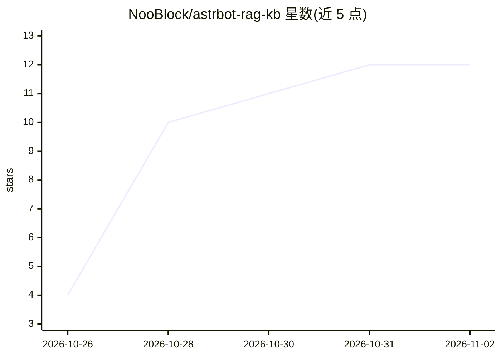

# NooBlock/astrbot-rag-kb

⭐ 12 · Python · NOASSERTION · 推送 2026-10-25 · [GitHub](https://github.com/NooBlock/astrbot-rag-kb) · 个人维护 · 中文 README

**中文互联网梗/黑话 RAG 语料库（4544 chunk）附 AstrBot 导入工具**

面向中文聊天机器人的 RAG 语料工程：5 个分层知识库（网络流行语释义、网梗对话风格、弱智吧、V吧黑话、地狱笑话）合计 4544 个 chunk，整理为可直接导入 AstrBot 内置知识库的 chunks.jsonl，附构建、导入、校验脚本与 wiki 文档。导入脚本在 AstrBot v4.29.3 的 /api/v1 接口上验证，需 OpenAI 兼容 embedding 模型（快照用 Qwen3-Embedding-8B）。语料为公开数据二次清洗，多数上游许可未声明，商用与再分发需自行核对。chunks.jsonl 不与 AstrBot 绑定，可被任意向量库读取。

## 筛选速览

| 维度 | 判定 | 备注 |
|---|---|---|
| AI 角色 | `ai-knowledge` | 知识聚合/清单类 |
| 许可风险 | `none` | NOASSERTION |
| 部署形态 | `desktop` | 安装包/桌面程序 |
| 模型依赖 | — | README 未给出锁定关系 |
| 硬件要求 | — | 无带数字的原话,不猜 |
| 安装摩擦 | `low` | 无编译、无系统依赖或容器化 |
| 成熟度 | — | 结构信号不足 |

## 能力要点

- 5 个分层知识库共 4544 个 chunk，含来源与许可状态逐库标注
- 提供 AstrBot 导入/校验脚本（v4.29.3 /api/v1 验证）
- chunks.jsonl 可被 LangChain/Dify/LlamaIndex 等任意向量库直接读取
- 每库提供 manifest.json 记录来源 URL、构建方式与已知局限

## 适用场景

- 为我的中文聊天机器人补上梗与社区语气的知识库
- 按需检索网络流行语的释义、出处与语境
- 研究中文互联网梗语料的分层组织与清洗方法

## 场景标签

`RAG` `知识库管理` · 领域:知识与检索

## 证据(README 行号)

> L1: # astrbot-rag-kb — 中文互联网梗 RAG 语料库（AstrBot 知识库）
> L3: 给中文聊天机器人补上「梗、黑话、社区语气」的 RAG 语料工程：**5 个按层次组织的中文互联网语料库**，已整理成可直接导入 AstrBot 内置知识库（v3.5.13 起提供）的 `chunks.jsonl`，并附带构建、导入、
> L25: |核心释义层|**网络流行语释义库**|🗣️|1219|SCUNLP/Buzzword（Cheer，ACL 2025），1183 个词条全量|上游无 LICENSE，研究/自用；再分发需授权并引用论文|

## 星数曲线

2026-10-26 4 → 2026-11-02 12（+8）

---
*卡片 v1 · prompt 1.4 · 生成 2026-11-01 · 置信度 mid · 依据 README sha `db62ae6639cf` · [字段定义](../../DATASET.md)*
