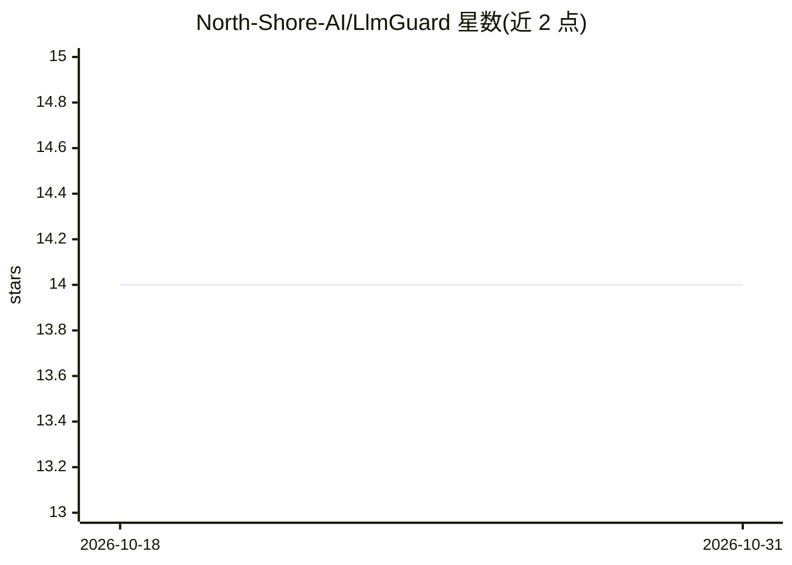

# North-Shore-AI/LlmGuard

⭐ 14 · Elixir · MIT · 推送 2026-04-04 · [GitHub](https://github.com/North-Shore-AI/LlmGuard) · 组织维护

**Elixir 应用的 LLM 防火墙：提示注入检测与 PII 脱敏**

面向基于 LLM 的 Elixir 应用的安全防护库，通过多层检测流水线提供提示注入检测（34+ 模式）、越狱检测（角色扮演/编码攻击/情感操纵等）、PII 检测与脱敏（邮箱、电话、SSN、信用卡、IP、URL），并以零信任方式校验输入与输出。支持缓存、Telemetry 指标（Prometheus/LiveDashboard）与批量和并发校验。处于 Phase 1 开发阶段，内容审核、速率限制、审计日志及 ML 分类层尚未实现，安装方式为 Hex 依赖（~> 0.3.1）。

## 筛选速览

| 维度 | 判定 | 备注 |
|---|---|---|
| AI 角色 | `ai-ecosystem` | LLM/agent 周边工具 |
| 许可风险 | `permissive` | MIT |
| 部署形态 | `None` |  |
| 模型依赖 | — | README 未给出锁定关系 |
| 硬件要求 | — | 无带数字的原话,不猜 |
| 安装摩擦 | `low` | 无编译、无系统依赖或容器化 |
| 成熟度 | `idea` | |

## 能力要点

- 多层检测流水线架构，模式匹配延迟 <15ms
- 34+ 模式的提示注入检测与 6 类越狱攻击检测
- PII 检测与脱敏（含 Luhn 校验的信用卡识别）
- 可嵌入 Phoenix Plug 与 CrucibleIR 研究流水线

## 适用场景

- 为 Elixir LLM 应用在输入输出两侧拦截提示注入
- 对话数据送入模型前脱敏 PII 信息
- 通过 Telemetry 监控检测延迟与请求结果

## 场景标签

`网络安全` · 领域:学习与行业

## 证据(README 行号)

> L13: LlmGuard provides comprehensive security protection for LLM applications including prompt injection detection, jail
> L20: - ✅ **Pipeline Architecture** - Flexible, extensible security pipeline

## 星数曲线

2026-10-18 14 → 2026-10-31 14（+0）

---
*卡片 v1 · prompt 1.4 · 生成 2026-10-31 · 置信度 high · 依据 README sha `6b52c6bd9f97` · [字段定义](../../DATASET.md)*
