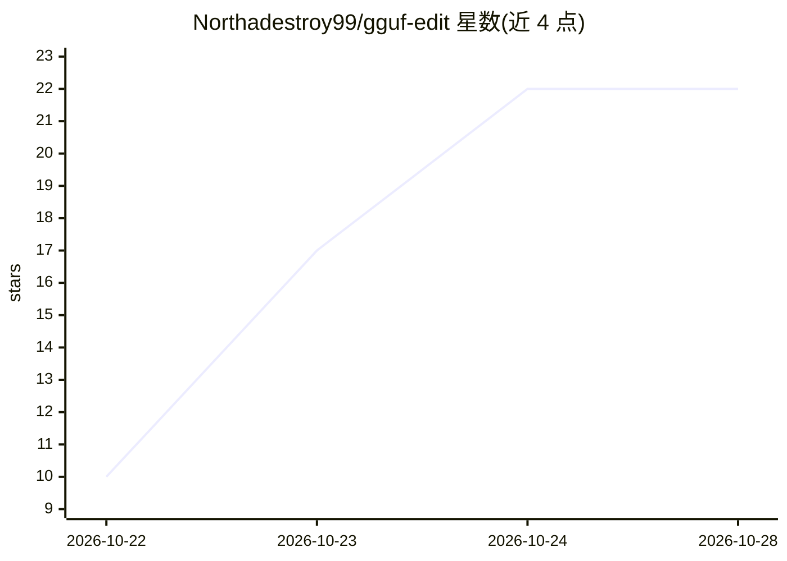

# Northadestroy99/gguf-edit

⭐ 22 · C# · MIT · 推送 2026-10-18 · [GitHub](https://github.com/Northadestroy99/gguf-edit) · 个人维护

**Windows 桌面 GGUF 元数据编辑器：免重量化改模板与参数**

面向本地 LLM 用户的 Windows 10/11 x64 桌面工具：直接编辑 GGUF 文件头部的聊天模板、系统提示、停止词、上下文长度及 rope scaling 等参数，写回时不触碰权重、无需重量化。内置 Jinja 与 ChatML 模板库并附实时渲染预览，保存前提供原始/修改 KV 对照视图，默认编辑副本，可选原位补丁模式，支持分片 GGUF 集合。以 100 MB 便携自包含 exe 分发（下载档案带密码），构建需 .NET 8 SDK。

## 筛选速览

| 维度 | 判定 | 备注 |
|---|---|---|
| AI 角色 | `ai-ecosystem` | LLM/agent 周边工具 |
| 许可风险 | `permissive` | MIT |
| 部署形态 | `None` |  |
| 模型依赖 | — | README 未给出锁定关系 |
| 硬件要求 | — | 无带数字的原话,不猜 |
| 安装摩擦 | `medium` | 含编译或系统依赖之一 |
| 成熟度 | — | 结构信号不足 |

## 能力要点

- 免重量化原位改写聊天模板、系统提示与上下文长度等头部 KV
- 内置 Jinja/ChatML 模板库与示例消息实时渲染预览
- 保存前原始/修改 KV 对照 diff，默认写副本可选原位补丁
- 100 MB 自包含便携 exe，离线运行，发布附 SHA-256 校验

## 适用场景

- 修正本地 GGUF 模型的聊天模板让回答恢复正常
- 不重量化地调整上下文长度、rope scaling 等参数
- 编辑分片 GGUF 模型集合的元数据

## 场景标签

 · 领域:本地 LLM 工具/模型文件编辑

## 证据(README 行号)

> L11: - ✅ **Edit without requanting** — chat template, system prompt, stop tokens and context length written in place, we
> L29: |Feature|**gguf-edit**|gguf-py scripts|LM Studio|KoboldCpp|

## 星数曲线

2026-10-22 10 → 2026-10-28 22（+12）

---
*卡片 v1 · prompt 1.4 · 生成 2026-10-27 · 置信度 high · 依据 README sha `b76f269e2347` · [字段定义](../../DATASET.md)*
