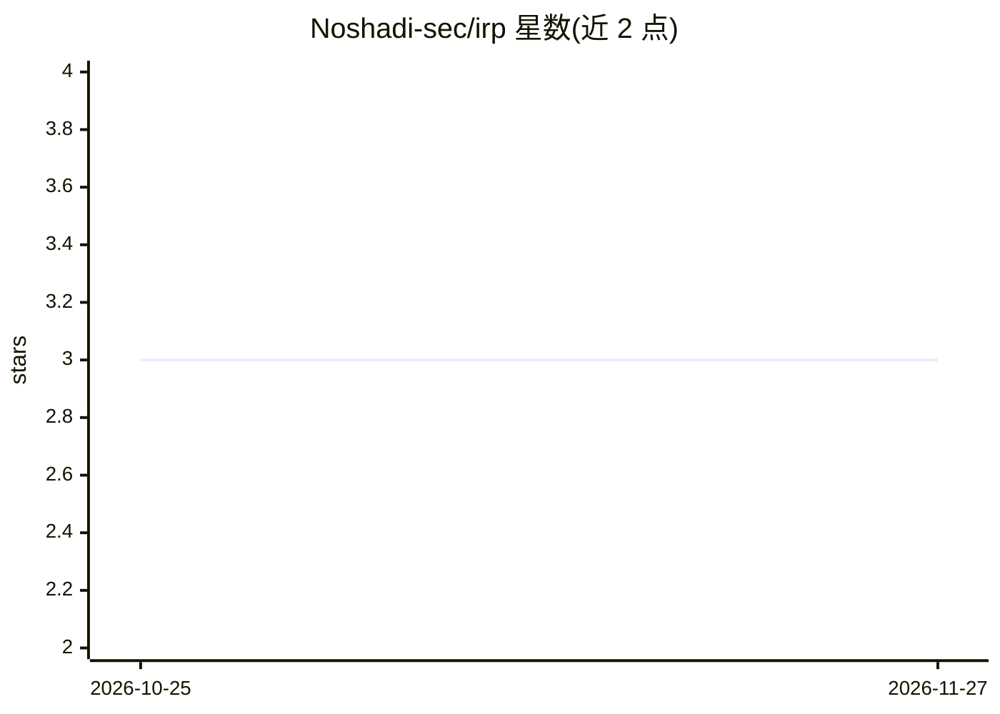

# Noshadi-sec/irp

⭐ 3 · Python · MIT · 推送 2026-11-06 · [GitHub](https://github.com/Noshadi-sec/irp) · 个人维护

**把论文转成可运行代码并逐条核验声明的 MCP 服务与 CLI**

IRP 由一个 MCP 服务器与 CLI 组成，接入 Claude Code、Codex、Cursor 等编码 agent，将研究论文转化为可运行的代码实现并生成逐条声明的复现报告。机制上：agent 读取论文并编写代码，IRP 负责抓取 arXiv 源、记录声明、创建 uv 或 Docker 环境、执行运行、从日志提取指标并写入仅基于哈希链证据日志的报告。IRP 本身不调用模型、无 API key，全部本地运行。要求 Python 3.11+，仅支持计算类论文，不支持湿实验与武器相关内容。

## 筛选速览

| 维度 | 判定 | 备注 |
|---|---|---|
| AI 角色 | `ai-ecosystem` | LLM/agent 周边工具 |
| 许可风险 | `permissive` | MIT |
| 部署形态 | `library` | 以包/库形式分发 |
| 模型依赖 | — | README 未给出锁定关系 |
| 硬件要求 | — | 无带数字的原话,不猜 |
| 安装摩擦 | `low` | 无编译、无系统依赖或容器化 |
| 成熟度 | — | 结构信号不足 |

## 能力要点

- append-only 哈希链证据日志，报告仅从日志生成并可用 verify 复检
- 四类判定：reproduced / close / not reproduced / could not run
- 支持 uv 虚拟环境或 Docker 隔离环境，带锁文件
- Modal GPU 沙箱可选，需预算记录与费用估算审批

## 适用场景

- 让 agent 依据论文重建缺失代码并核对论文中的数字
- 逐条验证一篇 ML/算法论文的声明是否可复现
- 在不信任 agent 的前提下人工审查每条结论的证据链

## 场景标签

`科研工具` · 领域:学习与行业

## 证据(README 行号)

> L33: IRP connects your agent (Claude Code, Codex or Cursor) to tools for paper
> L35: tools from your terminal. Everything runs locally; IRP never calls a model,
> L106: paper, writes code and decides what to run. Every action goes through one core,

## 星数曲线

2026-10-25 3 → 2026-11-27 3（+0）

---
*卡片 v1 · prompt 1.4 · 生成 2026-11-22 · 置信度 high · 依据 README sha `673c7f067724` · [字段定义](../../DATASET.md)*
