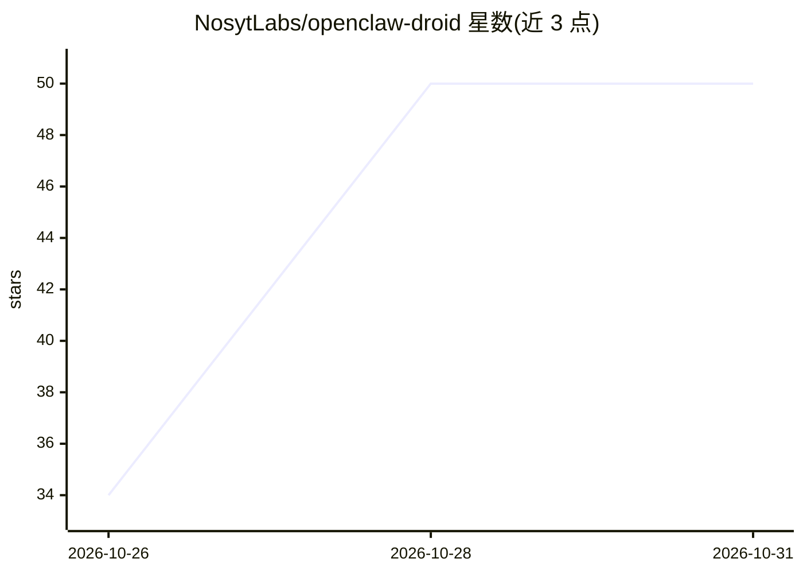

# NosytLabs/openclaw-droid

⭐ 50 · Shell · MIT · 推送 2026-08-29 · [GitHub](https://github.com/NosytLabs/openclaw-droid) · [官网](https://github.com/NosytLabs/openclaw-droid) · 组织维护

**在 Android Termux 上一键安装 OpenClaw AI 网关的脚本**

基于 Sagar Tamang 的 Bionic Bypass 指南编写的自动化安装脚本：在 Termux 中通过 proot-distro 安装 Ubuntu 容器，容器内安装 curl/git/build-essential、Node.js 22 与 openclaw，并创建 hijack.js 补丁（置空 os.networkInterfaces）绕过系统检测。安装后通过 openclaw 配置向导设置网关（须绑定 127.0.0.1 回环）、LLM 模型及 Telegram/WhatsApp 社交通道，支持语音集成，零 root 运行。面向想在手机上运行本地 LLM 网关的用户。

## 筛选速览

| 维度 | 判定 | 备注 |
|---|---|---|
| AI 角色 | `ai-ecosystem` | LLM/agent 周边工具 |
| 许可风险 | `permissive` | MIT |
| 部署形态 | `None` |  |
| 模型依赖 | — | README 未给出锁定关系 |
| 硬件要求 | — | 无带数字的原话,不猜 |
| 安装摩擦 | `medium` | 含编译或系统依赖之一 |
| 成熟度 | — | 结构信号不足 |

## 能力要点

- 单条 curl 命令在 Termux 中自动完成 Ubuntu 容器与 OpenClaw 安装
- Bionic Bypass（hijack.js + NODE_OPTIONS）绕过 Android 环境限制
- 零 root，基于 Termux + proot-distro 运行
- 配置向导支持网关绑定、LLM 模型与 Telegram/WhatsApp 配对

## 适用场景

- 在 Android 手机上部署 OpenClaw AI 网关运行本地 LLM
- 通过 Telegram/WhatsApp 将手机 LLM 接入社交渠道
- 无 root 权限的移动设备上搭建 AI agent 环境

## 场景标签

`模型网关` `AI 助手` · 领域:Agent 开发

## 证据(README 行号)

> L5: This installer automates the exact steps from the "Bionic Bypass" guide to run OpenClaw on Android using Termux and 
> L13: - **Automated Setup**: Installs Node 22, OpenClaw, and the Bionic Bypass automatically.

## 星数曲线

2026-10-26 34 → 2026-10-31 50（+16）

---
*卡片 v1 · prompt 1.4 · 生成 2026-10-25 · 置信度 high · 依据 README sha `97e651ba9474` · [字段定义](../../DATASET.md)*
