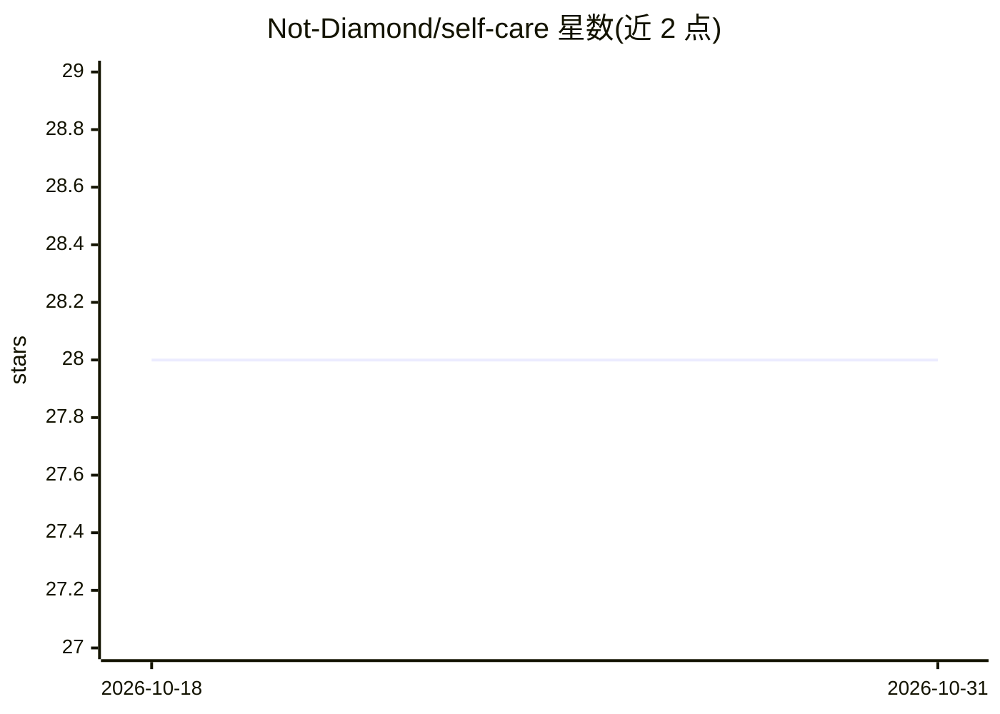

# Not-Diamond/self-care

⭐ 28 · JavaScript · MIT · 推送 2026-04-16 · [GitHub](https://github.com/Not-Diamond/self-care) · 组织维护

**Claude Code 插件：分析 agent 追踪并自动修复质量问题**

面向 Claude Code 的插件，从 LangSmith、LangFuse 或本地 OTEL/Claude Code 格式文件导入 agent 追踪，运行 14 种检测技能识别目标漂移、幻觉、步骤遗漏等问题，生成分诊报告；对可自动修复的案例扫描代码库定位相关文件（系统提示、工具描述、上下文文档），生成 diff，经预览批准后应用；支持定时轮询做持续监控。检测技能可启停、严重度可覆盖、追踪可按通配符排除。

## 筛选速览

| 维度 | 判定 | 备注 |
|---|---|---|
| AI 角色 | `ai-ecosystem` | LLM/agent 周边工具 |
| 许可风险 | `permissive` | MIT |
| 部署形态 | `None` |  |
| 模型依赖 | — | README 未给出锁定关系 |
| 硬件要求 | — | 无带数字的原话,不猜 |
| 安装摩擦 | `low` | 无编译、无系统依赖或容器化 |
| 成熟度 | — | 结构信号不足 |

## 能力要点

- 14 种检测技能覆盖目标漂移、幻觉、指令违背等问题
- 两阶段自动修复：预览 diff 后编辑项目文件（提示词/工具描述/上下文）
- 接入 LangSmith / LangFuse 追踪源及本地 OTEL 格式文件
- 定时轮询的持续监控与报告生成

## 适用场景

- 审查 agent 追踪中隐藏的目标漂移与幻觉等质量问题
- 通过修改系统提示与上下文文档修复 agent 问题的根因
- 对生产 agent 做定期抽样的持续质量监控

## 场景标签

`LLM 可观测性` `模型评测` · 领域:评测与运维

## 证据(README 行号)

> L8: **Your AI agents fail in subtle ways** — they drift from goals, ignore context, skip steps, or hallucinate mid-task.

## 星数曲线

2026-10-18 28 → 2026-10-31 28（+0）

---
*卡片 v1 · prompt 1.4 · 生成 2026-10-26 · 置信度 high · 依据 README sha `a1912f0010d4` · [字段定义](../../DATASET.md)*
