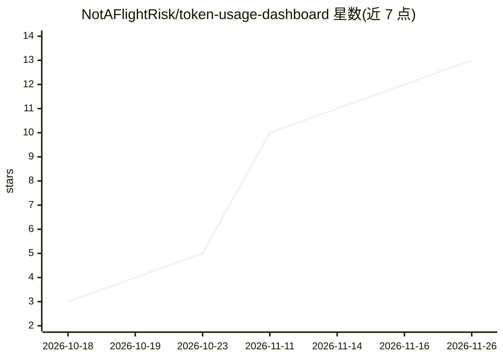

# NotAFlightRisk/token-usage-dashboard

⭐ 13 · TypeScript · MIT · 推送 2026-11-19 · [GitHub](https://github.com/NotAFlightRisk/token-usage-dashboard) · 个人维护

**为 Claude Code/Codex/OpenCode 用户可视化本地 token 用量与成本**

读取本地 Claude Code、Codex 与 OpenCode 的会话记录，生成展示历史 token 用量的 Web 仪表盘：包含年度日历热力图、按工具/模型分层的每日总量、fresh input/output/缓存读写拆分、项目与模型归属，以及 Anthropic 和 OpenAI 的 5 小时/7 天窗口。数据在本地处理，统计缓存进 SQLite，成本按公开 API 费率估算。通过 npx 运行，默认监听 localhost:4747，支持 Docker、systemd 服务与源码构建部署。

## 筛选速览

| 维度 | 判定 | 备注 |
|---|---|---|
| AI 角色 | `ai-ecosystem` | LLM/agent 周边工具 |
| 许可风险 | `permissive` | MIT |
| 部署形态 | `self-host` | docker 或自建部署 |
| 模型依赖 | — | README 未给出锁定关系 |
| 硬件要求 | — | 无带数字的原话,不猜 |
| 安装摩擦 | `low` | 无编译、无系统依赖或容器化 |
| 成熟度 | — | 结构信号不足 |

## 能力要点

- 读取本地 Claude Code/Codex/OpenCode 转录文件，全程本地处理
- SQLite 缓存保留完整历史，即使原工具已裁剪旧转录
- 展示 fresh/output/缓存读写 token 拆分与按公开费率的成本估算
- 新增数据源只需在 src/lib/server/sources/ 添加一个文件

## 适用场景

- 查看自己各 AI 编码工具的历史 token 消耗分布
- 追踪 Anthropic/OpenAI 订阅的 5 小时与 7 天用量窗口
- 在原工具清理旧转录后仍保留完整用量历史

## 场景标签

`LLM 可观测性` · 领域:评测与运维

## 证据(README 行号)

> L11: This usage dashboard reads your local Claude Code, Codex and OpenCode transcripts and builds a beautiful dashboard 
> L17: The dashboard shows:

## 星数曲线

2026-10-18 3 → 2026-11-26 13（+10）

---
*卡片 v1 · prompt 1.4 · 生成 2026-11-18 · 置信度 high · 依据 README sha `3d00c8c526b5` · [字段定义](../../DATASET.md)*
