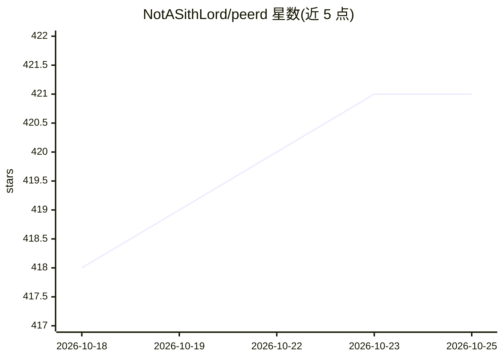

# NotASithLord/peerd

⭐ 421 · JavaScript · Apache-2.0 · 推送 2026-10-23 · [GitHub](https://github.com/NotASithLord/peerd) · [官网](https://peerd.ai) · 个人维护

**在浏览器内运行 AI agent 循环的扩展：驱动标签页并提供沙箱计算**

运行于 Chrome/Firefox 的 Manifest V3 浏览器扩展，实现完整的 agent 循环：agent 可读取并操作用户的标签页、网页应用与已登录会话，并在浏览器边界内运行 JS Notebook、WASI 工具、App 与 Linux WebVM 等沙箱计算。推理可选托管模型（BYOK）、localhost 本地模型或初步的 WebGPU 本地模型。主 agent 将环境工作委派给各自隔离 worker 堆中的 keyless actor，凭据、网络策略与审计保留在扩展侧。面向在浏览器中工作且不依赖后端的用户；无产品遥测。WebVM 仅支持 Chromium，Firefox 部分功能受限。

## 筛选速览

| 维度 | 判定 | 备注 |
|---|---|---|
| AI 角色 | `ai-ecosystem` | LLM/agent 周边工具 |
| 许可风险 | `permissive` | Apache-2.0 |
| 部署形态 | `None` |  |
| 模型依赖 | — | README 未给出锁定关系 |
| 硬件要求 | — | 无带数字的原话,不猜 |
| 安装摩擦 | `low` | 无编译、无系统依赖或容器化 |
| 成熟度 | `idea` | |

## 能力要点

- agent 可读取并驱动用户标签页、网页应用与已登录会话
- 沙箱计算：JS Notebook、编译 WASI 工具、App、Linux WebVM（Chromium 限定）
- BYOK 托管模型 / localhost 本地模型 / 初步 WebGPU 本地模型可选
- 通过 WebRTC 进行浏览器间发现与 agent 间通信（仅 preview 构建）

## 适用场景

- 让 agent 直接在我已登录的网页应用里替我完成任务
- 在浏览器沙箱内给 agent 提供本地计算（Notebook、WebVM）而不暴露操作系统
- 无后端、无账号地在浏览器中运行自选模型的 agent

## 场景标签

`浏览器自动化` `Agent 框架` · 领域:Agent 开发

## 证据(README 行号)

> L19: peerd is the first general-purpose agent runtime built directly on browser primitives: Workers, origins, sandboxing
> L23: For actual inference you can choose a supported hosted model provider, a local model using localhost, or check out 

## 星数曲线

2026-10-18 418 → 2026-10-25 421（+3）

---
*卡片 v1 · prompt 1.4 · 生成 2026-10-21 · 置信度 mid · 依据 README sha `3ee1bccb0d81` · [字段定义](../../DATASET.md)*
