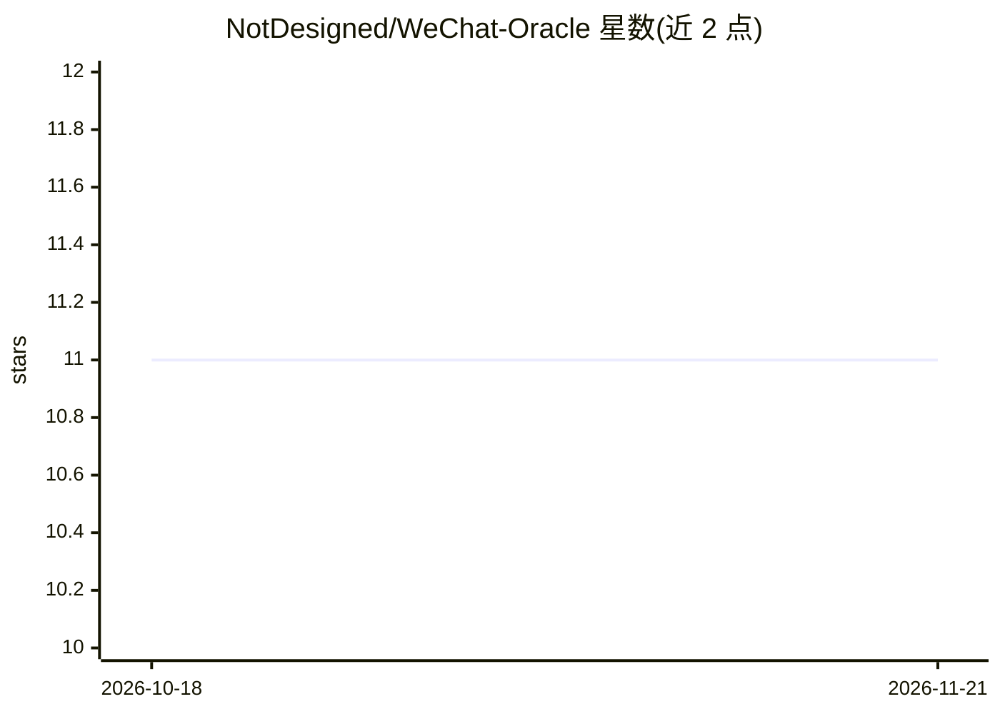

# NotDesigned/WeChat-Oracle

⭐ 11 · Python · MIT · 推送 2026-06-08 · [GitHub](https://github.com/NotDesigned/WeChat-Oracle) · 个人维护 · 中文 README

**本地微信群聊归档+群里@机器人问答的 LLM 助手**

通过 WeFlow SSE 采集微信群消息存入 SQLite，支持历史 JSON 导出回填、本地 OCR 图像识别与语音转录；通过 wx4py UI 自动化在群内回复，支持 /find、/sum、/ask 等斜杠命令与自由对话，后台维护每群长期记忆。需 Windows 10/11、微信 PC 4.1.8.107、WeFlow HTTP API、Python 3.12+ 与 uv；数据保留在本地 data/ 目录。仅一个 wx4py 发送线程串行化 GUI 操作。

## 筛选速览

| 维度 | 判定 | 备注 |
|---|---|---|
| AI 角色 | `ai-native` | 本体是模型或模型工具 |
| 许可风险 | `permissive` | MIT |
| 部署形态 | `None` |  |
| 模型依赖 | — | README 未给出锁定关系 |
| 硬件要求 | — | 无带数字的原话,不猜 |
| 安装摩擦 | `low` | 无编译、无系统依赖或容器化 |
| 成熟度 | — | 结构信号不足 |

## 能力要点

- WeFlow SSE 实时采集+历史 JSON 回填，SQLite 去重存储
- 本地 OCR/ASR 处理图片与语音消息
- wx4py UI 自动化群内回复，@/引用/概率三种触发路径
- 可切换原生 OpenAI 兼容后端或 OpenClaw 运行时，含 stdio MCP 入口

## 适用场景

- 把群聊历史做成可语义检索的本地归档
- 在群里 @ 机器人问"今天谁提到过 XX"
- 机器人长期潜入学习群话题并按策略主动发言

## 场景标签

`Agent 记忆` `语义搜索` `语音识别` `OCR` · 领域:Agent 开发

## 证据(README 行号)

> L7: WeChat Oracle records WeChat group messages through WeFlow, stores them in SQLite, optionally OCRs images and transc
> L49: - An OpenAI-compatible LLM endpoint, or OpenClaw local gateway for `WO_AGENT_BACKEND=openclaw`.
> L84: WO_AGENT_BACKEND=native

## 星数曲线

2026-10-18 11 → 2026-11-21 11（+0）

---
*卡片 v1 · prompt 1.4 · 生成 2026-11-19 · 置信度 high · 依据 README sha `3245affa0506` · [字段定义](../../DATASET.md)*
