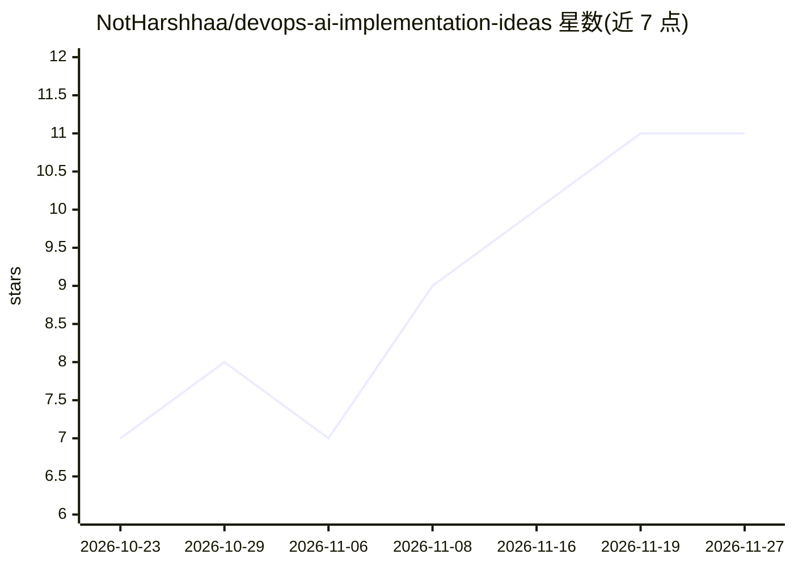

# NotHarshhaa/devops-ai-implementation-ideas

⭐ 11 · Python · MIT · 推送 2026-10-13 · [GitHub](https://github.com/NotHarshhaa/devops-ai-implementation-ideas) · [官网](https://devops-ai.prodevopsguytech.com) · 个人维护

**面向 DevOps/平台工程团队的 70 个 AI 落地思路架构集**

开源的 AI+DevOps 实践思路合集，当前收录 70 个想法，每个想法包含问题描述、AI 机会分析、建议方案与架构文档，覆盖 CI/CD、Kubernetes、IaC、云、可观测性/SRE、DevSecOps、开发者体验、平台工程与 Agentic DevOps 九大领域。仓库刻意不绑定单一 AI 供应商或框架，架构设计为各层可替换；另提供 GitHub Pages 静态站点用于浏览与检索目录，无构建步骤。README 明确不提供生产级实现代码，实现留待后续阶段。

## 筛选速览

| 维度 | 判定 | 备注 |
|---|---|---|
| AI 角色 | `ai-knowledge` | 知识聚合/清单类 |
| 许可风险 | `permissive` | MIT |
| 部署形态 | `library` | 以包/库形式分发 |
| 模型依赖 | — | README 未给出锁定关系 |
| 硬件要求 | — | 无带数字的原话,不猜 |
| 安装摩擦 | `low` | 无编译、无系统依赖或容器化 |
| 成熟度 | `idea` | |

## 能力要点

- 70 个已文档化的 AI+DevOps 想法，各含问题/AI 机会/方案/架构四部分
- 覆盖 CI/CD、Kubernetes、IaC、云、SRE、DevSecOps 等九大领域
- 多供应商设计：商业平台、本地推理、Agent 框架、MCP 服务器等分类列举
- GitHub Pages 静态站点提供可检索目录与架构图，无构建步骤

## 适用场景

- 为团队想引入 AI 的 DevOps 工作流寻找切入点与架构参考
- 评估 AI 在 CI/CD、Kubernetes 排障、事件响应中的适用环节
- 搭建内部 AI+DevOps 知识分享站点时复用其目录结构

## 场景标签

`教程课程` · 领域:学习与行业

## 证据(README 行号)

> L15: **DevOps AI Implementation Ideas** is an open-source collection of practical ideas for applying AI to real-world De
> L68: ### Current Phase: 💡 Ideas + Architecture — 70 ideas documented
> L21: This repository is **not tied to a single AI provider, model, framework, or cloud platform**. Ideas can be implemen

## 星数曲线

2026-10-23 7 → 2026-11-27 11（+4）

---
*卡片 v1 · prompt 1.4 · 生成 2026-11-19 · 置信度 high · 依据 README sha `59044a8ece2a` · [字段定义](../../DATASET.md)*
