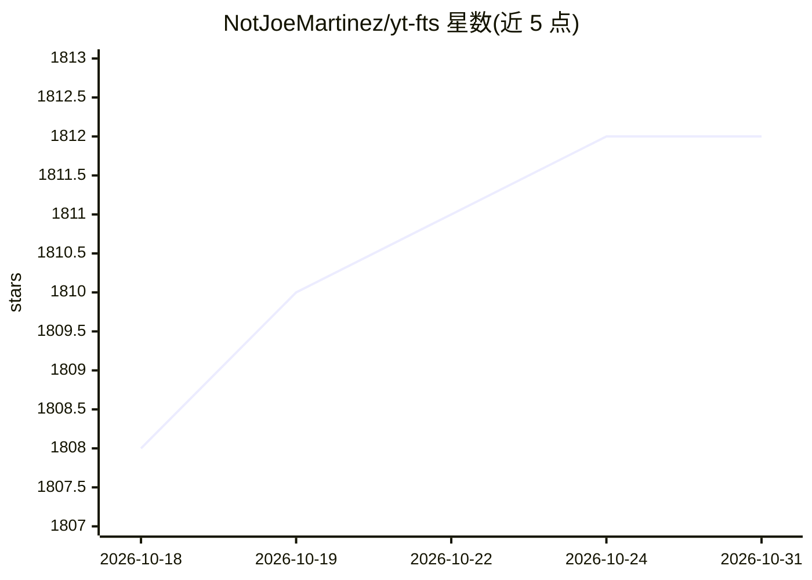

# NotJoeMartinez/yt-fts

⭐ 1,812 · Python · Unlicense · 推送 2026-01-22 · [GitHub](https://github.com/NotJoeMartinez/yt-fts) · 个人维护

**命令行抓取 YouTube 频道字幕并做全文/语义检索的工具**

基于 yt-dlp 抓取指定频道或播放列表的全部字幕并存入 sqlite 数据库，支持全文检索（sqlite 增强查询语法）并生成带时间戳的视频 URL。可选启用语义检索：通过 OpenAI 或 Gemini embeddings API 生成向量并存入 chromadb，之后可用 vsearch 向量检索、llm 对话（以检索结果为上下文）和 summarize 视频摘要命令。以 pip 安装的 CLI 形式提供。README 第 3 行声明本项目已 abandoned（弃置），属使用时需注意的限制。

## 筛选速览

| 维度 | 判定 | 备注 |
|---|---|---|
| AI 角色 | `ai-enhanced` | 去掉 AI 部分产品仍成立 |
| 许可风险 | `permissive` | Unlicense |
| 部署形态 | `library` | 以包/库形式分发 |
| 模型依赖 | — | README 未给出锁定关系 |
| 硬件要求 | — | 无带数字的原话,不猜 |
| 安装摩擦 | `low` | 无编译、无系统依赖或容器化 |
| 成熟度 | — | 结构信号不足 |

## 能力要点

- yt-dlp 抓取频道/播放列表字幕入 sqlite，全文检索输出带时间戳 URL
- 可选 OpenAI/Gemini embeddings + chromadb 语义检索（vsearch）
- 以语义检索结果为上下文的 llm 对话命令，含上下文自动更新机制
- 字幕导出 txt/vtt、搜索结果导出 CSV、403 诊断命令

## 适用场景

- 我想在下载过的 YouTube 频道字幕里搜某句话并跳到对应时间点
- 我想对频道字幕做语义检索而不是逐字匹配
- 我想基于频道内容做问答对话或视频摘要

## 场景标签

`语义搜索` · 领域:知识与检索

## 证据(README 行号)

> L5: `yt-fts` is a command line program that uses yt-dlp to scrape all of a YouTube
> L10: It also supports semantic search via the OpenAI embeddings API, Gemini embedding API and using chromadb.

## 星数曲线

2026-10-18 1,808 → 2026-10-31 1,812（+4）

---
*卡片 v1 · prompt 1.4 · 生成 2026-10-21 · 置信度 high · 依据 README sha `00fc69f99e9b` · [字段定义](../../DATASET.md)*
