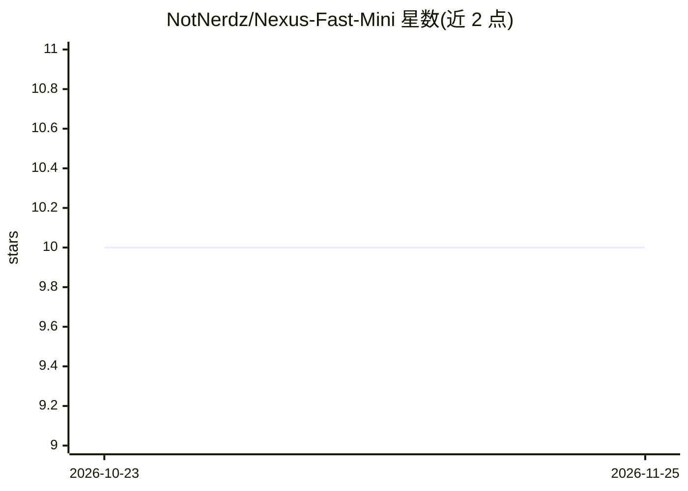

# NotNerdz/Nexus-Fast-Mini

⭐ 10 · TypeScript · 推送 2025-12-01 · [GitHub](https://github.com/NotNerdz/Nexus-Fast-Mini) · [官网](https://infiniax.ai) · 个人维护

**开发者用 TypeScript 编写的多模型编排推理框架**

一个多模型推理编排框架：并行运行 7 个“思考者”模型分别产出结构化分析，经 condenser 阶段合并为共识点、分歧与综合摘要，再由 chief reasoner 生成最终回答，支持流式与非流式输出。本体不训练也不托管模型，全部调用通过 OpenRouter API 完成，需用户提供 API key 与额度；每个 thinker 的模型、角色与提示词可自定义，支持任何 OpenRouter 兼容端点。

## 筛选速览

| 维度 | 判定 | 备注 |
|---|---|---|
| AI 角色 | `ai-ecosystem` | LLM/agent 周边工具 |
| 许可风险 | `none` | — |
| 部署形态 | `None` |  |
| 模型依赖 | locked-api |  |
| 硬件要求 | — | 无带数字的原话,不猜 |
| 安装摩擦 | `low` | 无编译、无系统依赖或容器化 |
| 成熟度 | `idea` | |

## 能力要点

- 7 个并行 thinker + condenser 汇总 + chief reasoner 三段流水线
- 支持流式与非流式输出，提供开发者集成 API
- thinker 的模型/角色/提示词可自由配置
- 兼容任意 OpenRouter 端点，不含模型权重

## 适用场景

- 将多个 LLM 的观点汇总为单一结构化回答
- 实验多角色协作推理流水线
- 基于 OpenRouter 模型搭建可定制推理管道

## 场景标签

`多智能体` · 领域:Agent 开发

## 证据(README 行号)

> L3: Nexus Fast Mini is a multi-model reasoning framework built around a simple idea:
> L15: Instead, it orchestrates external LLMs through the OpenRouter API.

## 星数曲线

2026-10-23 10 → 2026-11-25 10（+0）

---
*卡片 v1 · prompt 1.4 · 生成 2026-11-20 · 置信度 high · 依据 README sha `6f849ec030cf` · [字段定义](../../DATASET.md)*
