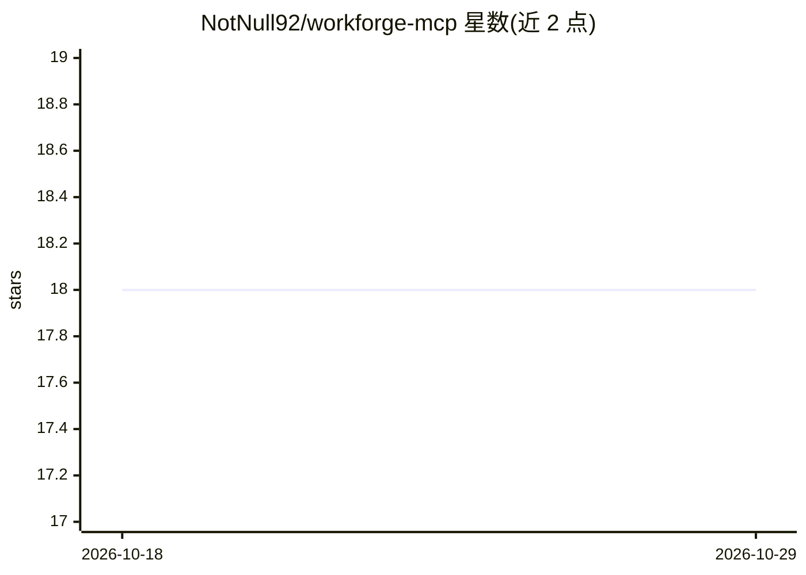

# NotNull92/workforge-mcp

⭐ 18 · TypeScript · MIT · 推送 2026-10-27 · [GitHub](https://github.com/NotNull92/workforge-mcp) · 个人维护 · 中文 README

**Windows/macOS 工作站 MCP 网关：让 ChatGPT 操作本机文件与命令**

面向 Windows（便携发行版）与 macOS（Apple Silicon/Intel 源码预览）的通用工作站 MCP 服务器，把 ChatGPT 接入本地文件读取与有界搜索、SHA-256 保护的受控编辑、图像读取、分支/提交等 Git 状态检查，以及带启动/状态/输出/取消分离操作的受监督 PowerShell 任务。提供 25 个 MCP 工具，含 project_resume 恢复项目上下文；Git 为可选增强，默认模式为普通本地文件夹。Windows 安装为下载 ZIP 后运行 Setup.cmd 三步流程，随包附带 Node.js 24 与 ripgrep，两平台均需手动启动。

## 筛选速览

| 维度 | 判定 | 备注 |
|---|---|---|
| AI 角色 | `ai-ecosystem` | LLM/agent 周边工具 |
| 许可风险 | `permissive` | MIT |
| 部署形态 | `desktop` | 安装包/桌面程序 |
| 模型依赖 | — | README 未给出锁定关系 |
| 硬件要求 | — | 无带数字的原话,不猜 |
| 安装摩擦 | `low` | 无编译、无系统依赖或容器化 |
| 成熟度 | — | 结构信号不足 |

## 能力要点

- 25 个 MCP 工具覆盖文件读取/搜索、受控编辑、Git 状态、图像、PowerShell 五组能力
- 基于当前 SHA-256 的受保护编辑，防止覆盖更新的文件内容
- PowerShell 任务分为启动/状态/输出/取消操作，连接断开不重放旧命令
- Windows 发行包内置 Node.js 24 与 ripgrep，Git 缺失不阻塞安装

## 适用场景

- 让 ChatGPT 直接检查项目文件与 Git 状态来修复构建或测试失败
- 久未接触的项目通过 resume 上下文与 Git 历史找回工作进度
- 让 ChatGPT 核对并更新 README 等文档使其与当前代码一致
- 对本地文件执行规则检查等重复性命令行工作流

## 场景标签

`编码 Agent` `工作流自动化` · 领域:效率与自动化

## 证据(README 行号)

> L9: WorkForge is a general-purpose workstation MCP server for Windows and macOS. It connects ChatGPT to local files, bou
> L110: WorkForge currently exposes 25 MCP tools, but you do not need to memorize their names. From a user's point of view

## 星数曲线

2026-10-18 18 → 2026-10-29 18（+0）

---
*卡片 v1 · prompt 1.4 · 生成 2026-10-29 · 置信度 mid · 依据 README sha `08d1638c0c68` · [字段定义](../../DATASET.md)*
