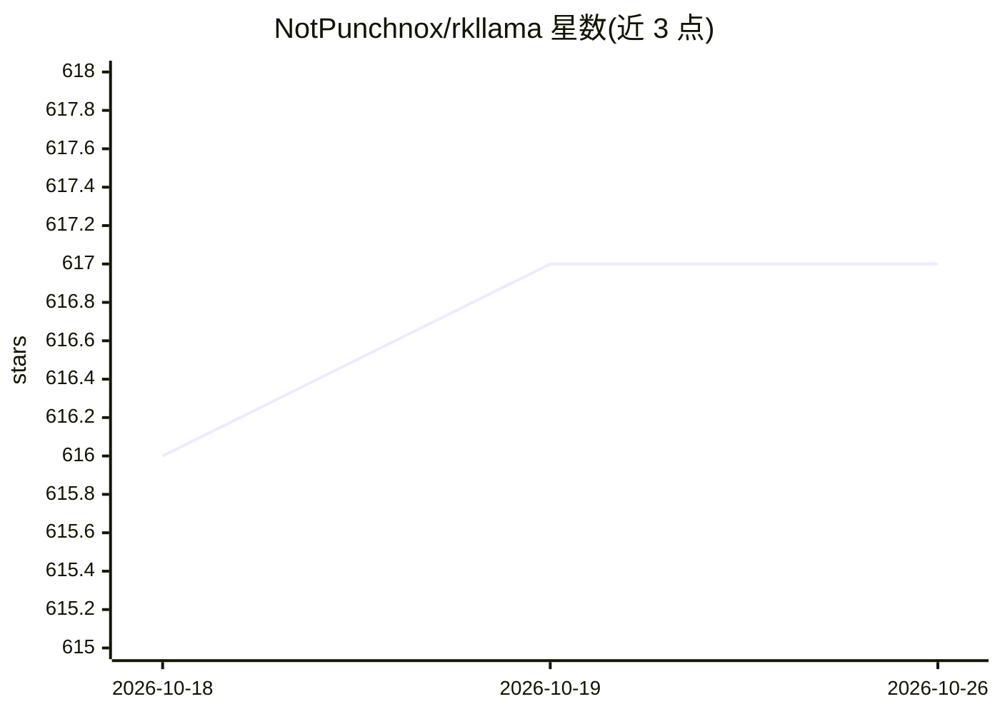

# NotPunchnox/rkllama

⭐ 617 · Python · GPL-3.0 · 推送 2026-08-25 · [GitHub](https://github.com/NotPunchnox/rkllama) · 个人维护

**在 Rockchip NPU 上运行 LLM 的服务器与客户端，兼容 Ollama API**

面向 Rockchip RK3588(S)/RK3576 设备（如 Orange Pi 5 系列、Radxa Rock 4d）的 LLM 推理服务器与客户端，通过 rkllm/rknn 运行时将模型跑在 NPU 上。提供 Ollama API 兼容（/api/chat、/api/generate 等）与部分 OpenAI API 兼容端点，支持工具调用、多模型并行加载与动态卸载、Prompt 缓存、多模态视觉模型、GGUF 模型（经 llama.cpp fork）、图像生成与 TTS/STT。以 pip 安装、Docker 镜像与命令行客户端分发，模型从 Hugging Face 拉取。限制：仅限 Rockchip 平台，测试环境为 arm64 Ubuntu/Armbian。

## 筛选速览

| 维度 | 判定 | 备注 |
|---|---|---|
| AI 角色 | `ai-ecosystem` | LLM/agent 周边工具 |
| 许可风险 | `viral` | GPL-3.0 |
| 部署形态 | `self-host` | docker 或自建部署 |
| 模型依赖 | local-ok | 支持本地模型 |
| 硬件要求 | — | 无带数字的原话,不猜 |
| 安装摩擦 | `low` | 无编译、无系统依赖或容器化 |
| 成熟度 | — | 结构信号不足 |

## 能力要点

- 模型运行于 Rockchip NPU（rkllm-runtime 1.3.0 / rknn-runtime 2.3.2）
- Ollama API 与部分 OpenAI API 兼容端点
- 工具/函数调用，支持 Qwen、Llama 3.2+ 等格式
- 多模态视觉、图像生成（LCM SD RKNN）、TTS/STT 能力

## 适用场景

- 在 Orange Pi 等 Rockchip 开发板上本地离线运行 LLM
- 用现有 Ollama/OpenAI 客户端对接 NPU 推理服务
- 在低功耗板卡上跑多模态视觉问答或语音生成

## 场景标签

`推理引擎` `语音合成` · 领域:内容生成

## 证据(README 行号)

> L17: A server to run and interact with LLM models optimized for Rockchip RK3588(S) and RK3576 platforms. The difference 
> L41: - **Ollama API compatibility** - Support for:

## 星数曲线

2026-10-18 616 → 2026-10-26 617（+1）

---
*卡片 v1 · prompt 1.4 · 生成 2026-10-21 · 置信度 high · 依据 README sha `744a230c2917` · [字段定义](../../DATASET.md)*
