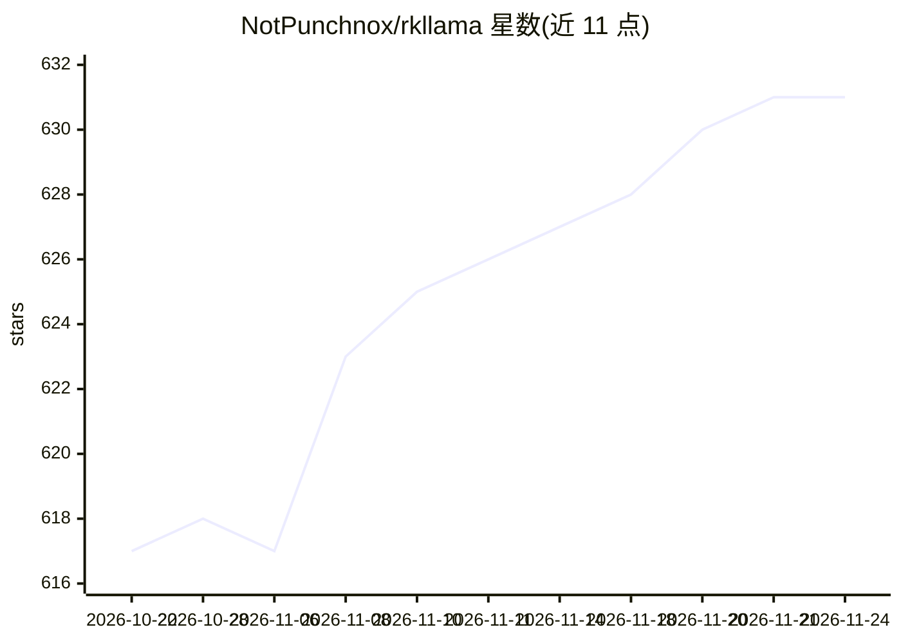

# NotPunchnox/rkllama

⭐ 631 · Python · GPL-3.0 · 推送 2026-10-28 · [GitHub](https://github.com/NotPunchnox/rkllama) · 个人维护

**在 Rockchip NPU 上运行 LLM 的服务器/客户端**

面向 RK3588(S)/RK3576 平台的 LLM 推理服务器与客户端，通过 rkllm/rknn 运行库将模型跑在 NPU 上。提供与 Ollama 及部分 OpenAI 兼容的 REST API，支持从 Hugging Face 拉取模型、动态加载/卸载、提示缓存、流式推理、工具调用，以及多模态视觉问答、图像生成、TTS/STT。支持 Python 3.9-3.12，可用源码安装或 Docker 运行；提供 Docker 分支与全模型测试分支。

## 筛选速览

| 维度 | 判定 | 备注 |
|---|---|---|
| AI 角色 | `ai-ecosystem` | LLM/agent 周边工具 |
| 许可风险 | `viral` | GPL-3.0 |
| 部署形态 | `self-host` | docker 或自建部署 |
| 模型依赖 | local-ok | 支持本地模型 |
| 硬件要求 | — | 无带数字的原话,不猜 |
| 安装摩擦 | `low` | 无编译、无系统依赖或容器化 |
| 成熟度 | — | 结构信号不足 |

## 能力要点

- 模型在 Rockchip NPU 上推理，自动检测 RK3588/RK3576 平台
- 兼容 Ollama API（/api/chat、/api/generate 等）与部分 OpenAI API 端点
- 多模型并行驻留内存，动态加载/卸载与按会话的提示缓存
- 支持多模态视觉模型、图像生成（RKNN 版 Stable Diffusion）与 TTS/STT

## 适用场景

- 在 Orange Pi 5 / Radxa Rock 等 Rockchip 板卡上离线运行 LLM
- 让现有调用 Ollama 或 OpenAI API 的客户端接入 NPU 推理后端
- 在本地设备上部署图像生成、语音合成与语音识别服务

## 场景标签

`推理引擎` `图像生成` `语音合成` `语音识别` · 领域:内容生成

## 证据(README 行号)

> L17: A server to run and interact with LLM models optimized for Rockchip RK3588(S) and RK3576 platforms. The difference 
> L41: - **Ollama API compatibility** - Support for:
> L59: - **Include a API REST with documentation.**

## 星数曲线

2026-10-22 617 → 2026-11-24 631（+14）

---
*卡片 v1 · prompt 1.4 · 生成 2026-11-24 · 置信度 high · 依据 README sha `eaadf000326c` · [字段定义](../../DATASET.md)*
