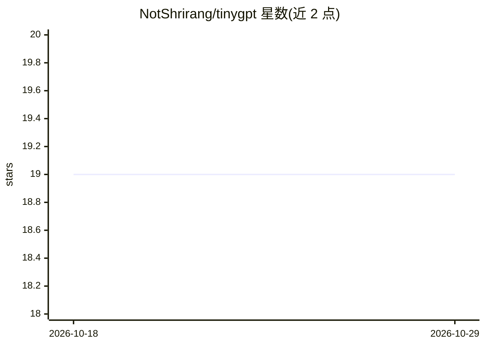

# NotShrirang/tinygpt

⭐ 19 · Jupyter Notebook · GPL-3.0 · 推送 2026-06-19 · [GitHub](https://github.com/NotShrirang/tinygpt) · [官网](https://tinygpt.streamlit.app/) · 个人维护

**教学向 GPT 系列：51M-183M 参数小型语言模型及指令微调版**

用 PyTorch 从零实现的 GPT 架构教学项目，包含五个模型变体：51M 标准 GPT、84M MoE、135M Wikipedia-MoE、95M TinyGPT2（RoPE/GQA/RMSNorm/KV Cache）与 183M TinyGPT2.1；在 SFT（Alpaca/SlimOrca）与 DPO（Anthropic HH-RLHF）后可指令跟随与偏好对齐。模型托管于 HuggingFace，提供 Streamlit 界面、CLI 推理（chat/instruction/raw 三模式）、FastAPI 服务与 Docker 部署。训练在单张 RTX 3070 Ti (8GB) 上完成；liger-kernel 仅限 Linux+CUDA，Windows/CPU 自动回退纯 PyTorch。

## 筛选速览

| 维度 | 判定 | 备注 |
|---|---|---|
| AI 角色 | `ai-native` | 本体是模型或模型工具 |
| 许可风险 | `viral` | GPL-3.0 |
| 部署形态 | `self-host` | docker 或自建部署 |
| 模型依赖 | — | README 未给出锁定关系 |
| 硬件要求 | `gpu-8g` | |
| 安装摩擦 | `low` | 无编译、无系统依赖或容器化 |
| 成熟度 | — | 结构信号不足 |

## 能力要点

- 五个模型变体，参数量 51M-183M，TinyGPT2 采用 RoPE/GQA/RMSNorm/KV Cache
- SFT（Alpaca/SlimOrca）与 DPO（Anthropic HH-RLHF）训练脚本，可在单张 8GB 显卡上完成
- 多种使用途径：HuggingFace 加载、Streamlit、CLI 推理、FastAPI REST API、Docker
- 跨平台运行：Windows/macOS/Linux，非 Linux+CUDA 环境自动回退纯 PyTorch

## 适用场景

- 学习 GPT 架构与 SFT/DPO 训练流程，配套训练 notebook
- 在消费级 GPU 上运行和微调小型文本生成模型
- 用 Streamlit 或 FastAPI 部署轻量文本生成服务

## 场景标签

`微调` `强化学习` `教程课程` · 领域:学习与行业

## 证据(README 行号)

> L11: **TinyGPT** is an educational implementation of the GPT (Generative Pre-trained Transformer) architecture, featurin
> L189: - **TinyGPT**: Standard 51M parameter model for story generation

## 星数曲线

2026-10-18 19 → 2026-10-29 19（+0）

---
*卡片 v1 · prompt 1.4 · 生成 2026-10-28 · 置信度 mid · 依据 README sha `b4cbb8333eb8` · [字段定义](../../DATASET.md)*
