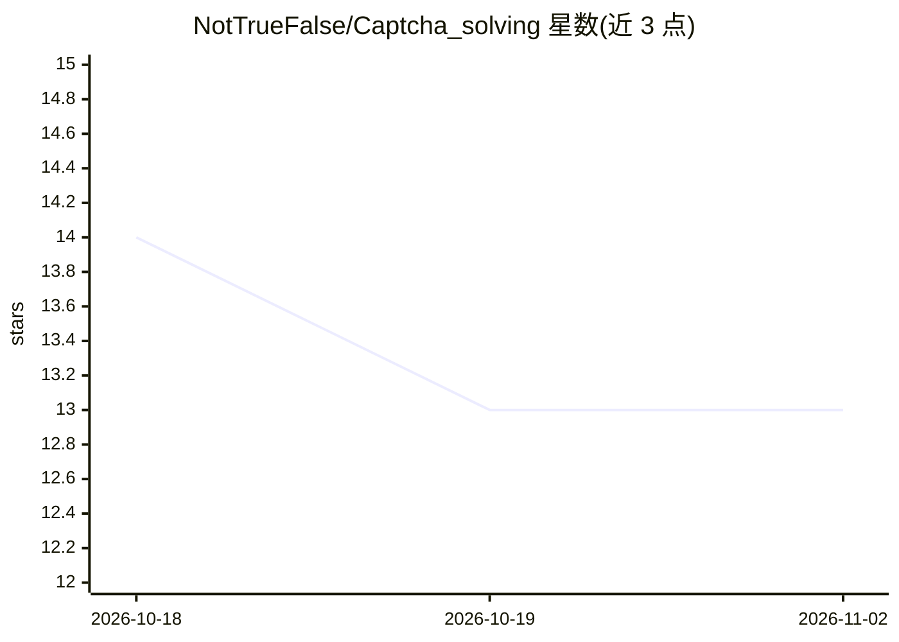

# NotTrueFalse/Captcha_solving

⭐ 13 · Python · BSD-3-Clause · 推送 2026-07-27 · [GitHub](https://github.com/NotTrueFalse/Captcha_solving) · 个人维护

**端到端验证码识别项目：生成数据集、预处理、训练并运行模型**

个人开发的验证码识别完整流程仓库，分四步：用 Node.js 的 generator.js（svg-captcha）生成验证码图像或解压自带数据集；用 opencv-python 做图像预处理；基于 Keras/TensorFlow 文档编写 MODEL_CREATION.py 训练模型（自动缩放裁剪图像、训练后保存并展示预测面板）；最后用 main.py 对 test 目录中的验证码输出预测与标签。面向想学习或复现验证码识别流程的开发者。Windows 下无 GPU 时建议使用 WSL2。预测不佳时需扩充数据集。

## 筛选速览

| 维度 | 判定 | 备注 |
|---|---|---|
| AI 角色 | `ai-native` | 本体是模型或模型工具 |
| 许可风险 | `permissive` | BSD-3-Clause |
| 部署形态 | `library` | 以包/库形式分发 |
| 模型依赖 | — | README 未给出锁定关系 |
| 硬件要求 | — | 无带数字的原话,不猜 |
| 安装摩擦 | `low` | 无编译、无系统依赖或容器化 |
| 成熟度 | — | 结构信号不足 |

## 能力要点

- generator.js 生成自定义验证码数据集（尺寸/格式可配）
- opencv-python 图像预处理脚本
- Keras/TensorFlow 模型训练并自动保存
- main.py 对新验证码输出预测与标签

## 适用场景

- 生成并预处理验证码数据集用于训练
- 训练一个识别图像验证码的模型
- 对测试目录中的验证码批量输出预测结果

## 场景标签

`OCR` · 领域:感知与多模态

## 证据(README 行号)

> L17: # STEP 3 - creation a model
> L35: - put test captcha as unprocessed (as normal, not preprocessed) in a directory named `test`, then simply run `pytho

## 星数曲线

2026-10-18 14 → 2026-11-02 13（-1）

---
*卡片 v1 · prompt 1.4 · 生成 2026-10-31 · 置信度 high · 依据 README sha `5a82d1fd7dd3` · [字段定义](../../DATASET.md)*
