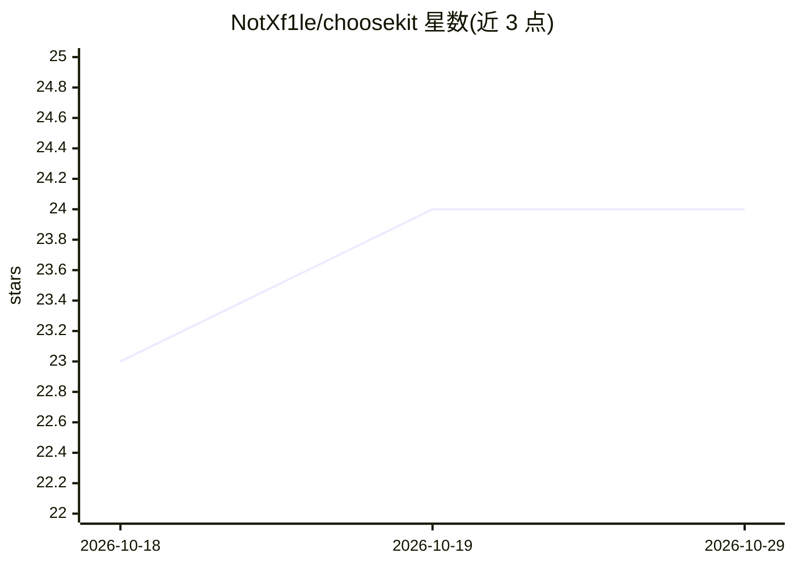

# NotXf1le/choosekit

⭐ 24 · JavaScript · Apache-2.0 · 推送 2026-10-26 · [GitHub](https://github.com/NotXf1le/choosekit) · 个人维护

**给开发者的类型化选择评分库：从文本/图像返回概率分布决策**

TypeScript 库，对有限选项集合打分并返回带概率分布的类型化决策：利用模型在区分选项的 token 分支上的条件对数概率进行评分，支持 labels 与 minimal-prefix 两种模式，结果不可变且无状态调用。后端支持 llama.cpp、Ollama 与 OpenRouter，图像输入支持 PNG/JPEG/WebP（需模型支持视觉）。另提供只含 choose/chooseMany 工具的 MCP 服务器，供 Claude Code、Codex、OpenCode 使用。无运行时依赖、无遥测，要求 Node.js 20+。

## 筛选速览

| 维度 | 判定 | 备注 |
|---|---|---|
| AI 角色 | `ai-ecosystem` | LLM/agent 周边工具 |
| 许可风险 | `permissive` | Apache-2.0 |
| 部署形态 | `library` | 以包/库形式分发 |
| 模型依赖 | local-ok | 支持本地模型 |
| 硬件要求 | — | 无带数字的原话,不猜 |
| 安装摩擦 | `low` | 无编译、无系统依赖或容器化 |
| 成熟度 | — | 结构信号不足 |

## 能力要点

- 基于条件对数概率的选项评分，返回归一化概率分布
- 三种后端：llama.cpp / Ollama / OpenRouter，均支持图像输入
- 提供 MCP 服务器（choose/chooseMany 只读工具）
- labels（最多 20-26 选项）与 minimal-prefix（llama.cpp 专属）两种评分模式

## 适用场景

- 为 agent 实现动作批准/拒绝、消息路由、工具选择的类型化决策
- 对多张截图做状态分类（加载中/就绪/错误）
- 在同一上下文上并发问多个独立问题（chooseMany）
- 通过 MCP 在 Claude Code/Codex/OpenCode 中调用选择能力

## 场景标签

 · 领域:LLM 工具库/Agent 基础设施

## 证据(README 行号)

> L3: `choosekit` scores a finite set of choices and returns a typed decision with a probability distribution.
> L55: `choosekit-mcp` provides read-only `choose` and `chooseMany` MCP tools through llama.cpp, Ollama, or OpenRouter for

## 星数曲线

2026-10-18 23 → 2026-10-29 24（+1）

---
*卡片 v1 · prompt 1.4 · 生成 2026-10-27 · 置信度 high · 依据 README sha `b496c3f93c23` · [字段定义](../../DATASET.md)*
