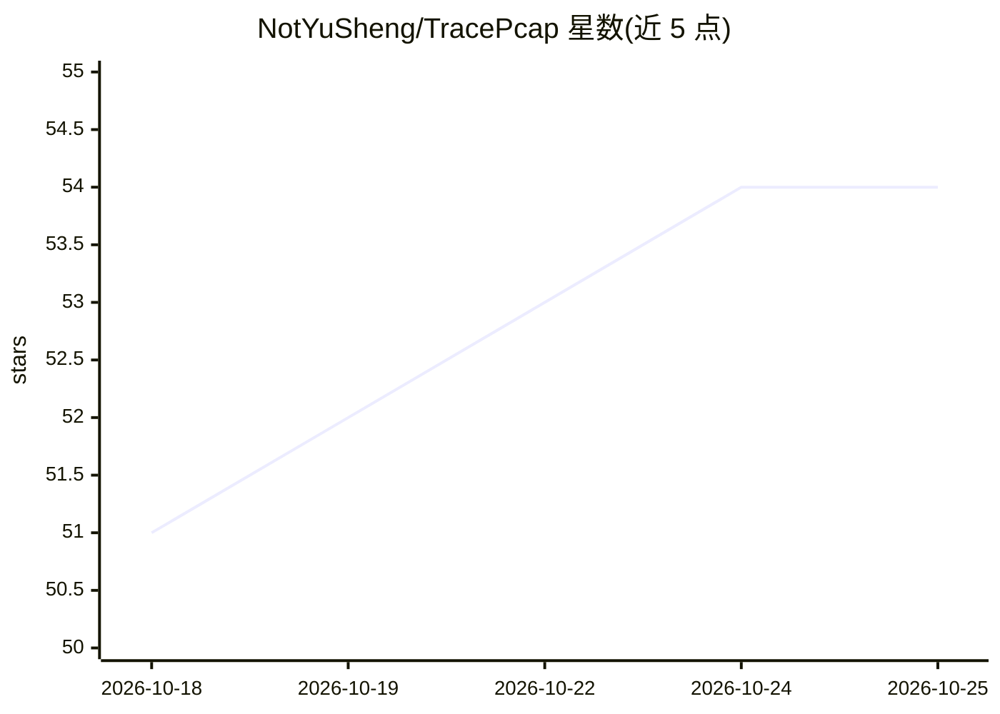

# NotYuSheng/TracePcap

⭐ 54 · Java · MIT · 推送 2026-10-24 · [GitHub](https://github.com/NotYuSheng/TracePcap) · [官网](https://notyusheng.github.io/TracePcap/) · 个人维护

**自托管黑盒网络流量取证平台：从 PCAP 重建网络与威胁全貌**

基于 Spring Boot + React + Docker 的自托管 PCAP 分析工作台：上传抓包文件后自动推断设备类型、子网与拓扑，重建 TCP/UDP 会话与 HTTP 文件，nDPI 深度包检测给出应用识别与风险标记，支持 YAML 自定义签名规则与多快照间变更检测。AI 功能（事件叙事生成、LLM 问答、自然语言生成 Wireshark 过滤器）依赖自建或局域网 OpenAI 兼容 LLM 端点，其余功能无需 LLM，可完全离线运行。面向应急响应、第三方网络审计、渗透侦察与教学场景。

## 筛选速览

| 维度 | 判定 | 备注 |
|---|---|---|
| AI 角色 | `ai-enhanced` | 去掉 AI 部分产品仍成立 |
| 许可风险 | `permissive` | MIT |
| 部署形态 | `self-host` | docker 或自建部署 |
| 模型依赖 | — | README 未给出锁定关系 |
| 硬件要求 | — | 无带数字的原话,不猜 |
| 安装摩擦 | `low` | 无编译、无系统依赖或容器化 |
| 成熟度 | — | 结构信号不足 |

## 能力要点

- 从流量推断设备分类、子网结构与拓扑，无需网络先验知识
- nDPI v5 深度包检测与 YAML 自定义签名规则（JA3/载荷正则等）
- 多快照网络监控：自动 diff 设备/IP/协议/VPN 变更并按严重度排序
- AI 生成事件叙事与自然语言转 Wireshark/tcpdump 过滤器（可选本地 LLM）

## 适用场景

- 拿到无文档的 PCAP 做第三方网络审计或取证重建
- 应急响应中从流量证据重建事件过程
- 对同一网络多次抓包，跟踪设备与拓扑漂移
- 离线/气隔环境下的流量分析与 PDF 报告导出

## 场景标签

`网络安全` · 领域:学习与行业

## 证据(README 行号)

> L17: **TracePcap** is a self-hosted PCAP analysis workbench for **black-box network analysis** — situations where you wo
> L121: > **Note:** First startup may take a minute while PostgreSQL and MinIO initialise. AI features require a running L
> L63: |**Story Mode**|AI-generated narrative reconstruction of network activity with an interactive LLM Q&A chat, custom 

## 星数曲线

2026-10-18 51 → 2026-10-25 54（+3）

---
*卡片 v1 · prompt 1.4 · 生成 2026-10-24 · 置信度 high · 依据 README sha `c4a58a48f8c6` · [字段定义](../../DATASET.md)*
