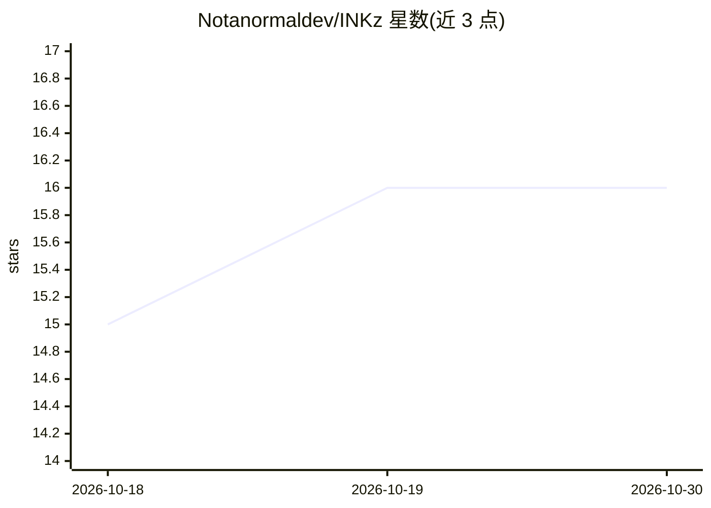

# Notanormaldev/INKz

⭐ 16 · JavaScript · MIT · 推送 2026-08-20 · [GitHub](https://github.com/Notanormaldev/INKz) · [官网](https://inkz-cloud-ide.netlify.app) · 个人维护

**浏览器云 IDE + 自主 AI 编程代理平台，跑在 Kubernetes 沙箱上**

个人独立开发的 Cloud IDE 与 Agentic AI 编程平台：5 个微服务经 REST 与 RabbitMQ 通信，Redis 管理沙箱 Pod 生命周期，浏览器内 Monaco 编辑器连接约 4 秒启动的 Kubernetes 容器。AI 部分为 LangChain ReAct 代理，可读取整个代码库、自主多文件编辑并执行终端命令，默认 Mistral，可换 Gemini/OpenAI/DeepSeek/Claude/离线 Ollama。支持 Docker Desktop/K3s 本地免费自托管，曾部署于 AWS EKS 但因云成本已关闭。给需要在浏览器中获得完整开发环境的开发者使用。

## 筛选速览

| 维度 | 判定 | 备注 |
|---|---|---|
| AI 角色 | `ai-ecosystem` | LLM/agent 周边工具 |
| 许可风险 | `permissive` | MIT |
| 部署形态 | `self-host` | docker 或自建部署 |
| 模型依赖 | local-ok | 支持本地模型 |
| 硬件要求 | — | 无带数字的原话,不猜 |
| 安装摩擦 | `low` | 无编译、无系统依赖或容器化 |
| 成熟度 | — | 结构信号不足 |

## 能力要点

- 5 微服务 + 3 边车架构，RabbitMQ 事件总线与 Redis TTL 生命周期管理
- LangChain ReAct 代理：全代码库上下文、自主多文件编辑、终端执行
- LLM 供应商可插拔（Mistral/Gemini/OpenAI/DeepSeek/Claude/Ollama）
- 云端依赖均有零成本本地替换（MinIO/mongo:7/redis:7/rabbitmq:3/Ollama）

## 适用场景

- 在浏览器中打开 URL 即获得带 AI 编程伙伴的隔离开发环境
- 本地用 Docker Desktop/K3s 免费自托管完整云 IDE
- 从本地开发无缝切换到 AWS EKS 生产部署

## 场景标签

`编码 Agent` · 领域:编码与开发

## 证据(README 行号)

> L62: |**ai-orchestration**|Runs the LangChain agent: reads, writes, and refactors your code autonomously|
> L72: The agent runs on Mistral by default, but the LangChain integration is fully pluggable: swap in Gemini 1.5 Pro, Ope

## 星数曲线

2026-10-18 15 → 2026-10-30 16（+1）

---
*卡片 v1 · prompt 1.4 · 生成 2026-10-30 · 置信度 high · 依据 README sha `6c729e3808c2` · [字段定义](../../DATASET.md)*
