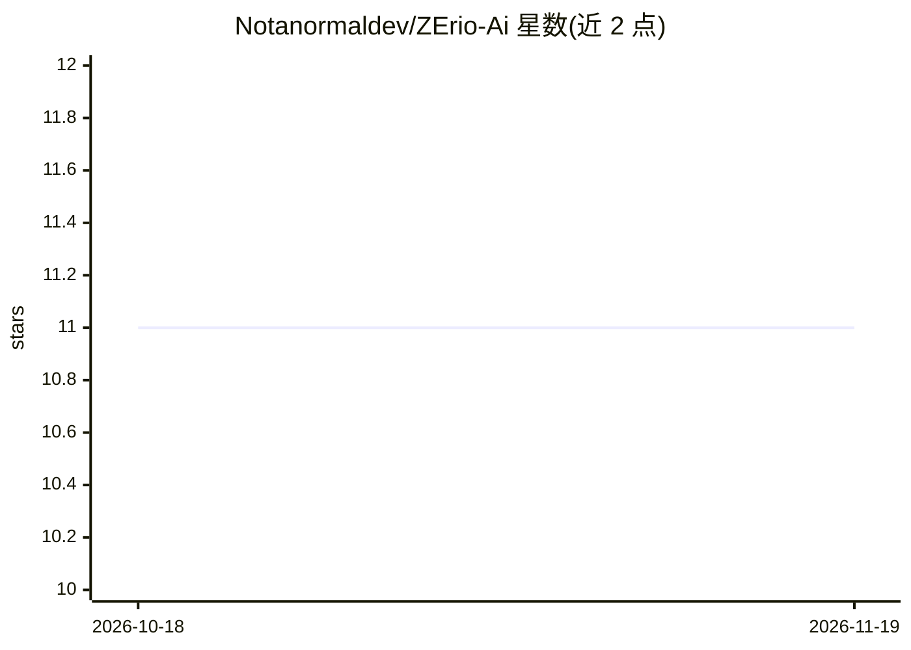

# Notanormaldev/ZErio-Ai

⭐ 11 · JavaScript · MIT · 推送 2026-05-23 · [GitHub](https://github.com/Notanormaldev/ZErio-Ai) · [官网](https://zerio-ai.onrender.com/) · 个人维护

**多模型 AI 聊天平台：集成 RAG、联网搜索与图片理解**

全栈 AI 聊天平台：在一个界面中接入 5 家 LLM（Gemini、GPT-4o/3.5、Mistral、Cohere Command、DeepSeek），支持一键切换。文档智能基于 RAG 流水线解析 PDF/DOCX/JSON；通过 Tavily 搜索 API 与 LangChain 做实时联网搜索并落地回答；图片经多模态模型理解；响应经 Socket.io 逐 token 流式输出。认证采用 JWT + Redis 令牌黑名单 + HttpOnly cookie，文件经 ImageKit CDN 存储。后端 Node.js/Express + MongoDB，前端 React + Vite。已部署在 Render，README 未提供本地安装步骤。

## 筛选速览

| 维度 | 判定 | 备注 |
|---|---|---|
| AI 角色 | `ai-native` | 本体是模型或模型工具 |
| 许可风险 | `permissive` | MIT |
| 部署形态 | `None` |  |
| 模型依赖 | locked-api |  |
| 硬件要求 | — | 无带数字的原话,不猜 |
| 安装摩擦 | `low` | 无编译、无系统依赖或容器化 |
| 成熟度 | — | 结构信号不足 |

## 能力要点

- 单界面接入 5 家 LLM，可切换模型而无需改业务逻辑
- RAG 流水线支持 PDF/DOCX/JSON 文档对话
- Tavily + LangChain 实时联网搜索落地回答
- Socket.io 逐 token 流式输出与 Redis 令牌黑名单认证

## 适用场景

- 在同一个聊天界面切换使用多家 LLM
- 上传 PDF/Word 文档并就其内容提问
- 需要结合实时网络信息回答问题
- 上传图片并让模型分析描述内容

## 场景标签

`聊天机器人` `RAG` `多模态` · 领域:对话与助手

## 证据(README 行号)

> L28: ZErio AI is a production-grade AI assistant platform that connects multiple state-of-the-art language models under 
> L43: ### 🧠 RAG — Document Intelligence

## 星数曲线

2026-10-18 11 → 2026-11-19 11（+0）

---
*卡片 v1 · prompt 1.4 · 生成 2026-11-19 · 置信度 high · 依据 README sha `1ee282331f2f` · [字段定义](../../DATASET.md)*
