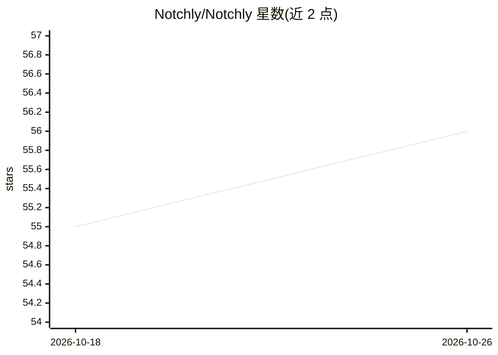

# Notchly/Notchly

⭐ 56 · Swift · MIT · 推送 2026-08-11 · [GitHub](https://github.com/Notchly/Notchly) · [官网](https://notchly.xyz) · 组织维护

**将 MacBook 刘海变为控制面的 macOS 应用，含 Codex AI 提醒**

原生 SwiftUI 应用，把 MacBook 刘海区域变成紧凑控制面：提供 Spotify/Apple Music 音乐控制、电池与充电指示、锁屏音乐控制、专注动画、滑动手势与多显示器行为，并可显示 Codex AI 会话的审批请求与任务完成提醒（通过本地 Stop hook 接收事件，可在设置中开启声音）。本地优先设计，声明不收集个人数据。要求 macOS 14.6 及以上，通过 Releases 下载 DMG 安装或从源码用 Xcode 构建。

## 筛选速览

| 维度 | 判定 | 备注 |
|---|---|---|
| AI 角色 | `ai-enhanced` | 去掉 AI 部分产品仍成立 |
| 许可风险 | `permissive` | MIT |
| 部署形态 | `None` |  |
| 模型依赖 | — | README 未给出锁定关系 |
| 硬件要求 | — | 无带数字的原话,不猜 |
| 安装摩擦 | `medium` | 含编译或系统依赖之一 |
| 成熟度 | — | 结构信号不足 |

## 能力要点

- 刘海区域音乐控制（Spotify/Apple Music）与电池指示
- Codex AI 审批与任务完成提醒（本地 Stop hook）
- 滑动手势、专注动画、多显示器主屏行为
- 本地优先设计，声明不收集个人数据

## 适用场景

- 在刘海处控制音乐播放和查看电池状态
- Codex 编码 agent 等待审批或任务完成时收到提醒
- 配合 Spotify/Apple Music 快速操作媒体播放

## 场景标签

 · 领域:macOS 桌面工具

## 证据(README 行号)

> L38: **Notchly** is a lightweight native macOS app that turns the MacBook notch into a compact control surface.
> L54: - Codex AI alerts for approval and task completion events.

## 星数曲线

2026-10-18 55 → 2026-10-26 56（+1）

---
*卡片 v1 · prompt 1.4 · 生成 2026-10-24 · 置信度 high · 依据 README sha `6509f5e0d10d` · [字段定义](../../DATASET.md)*
