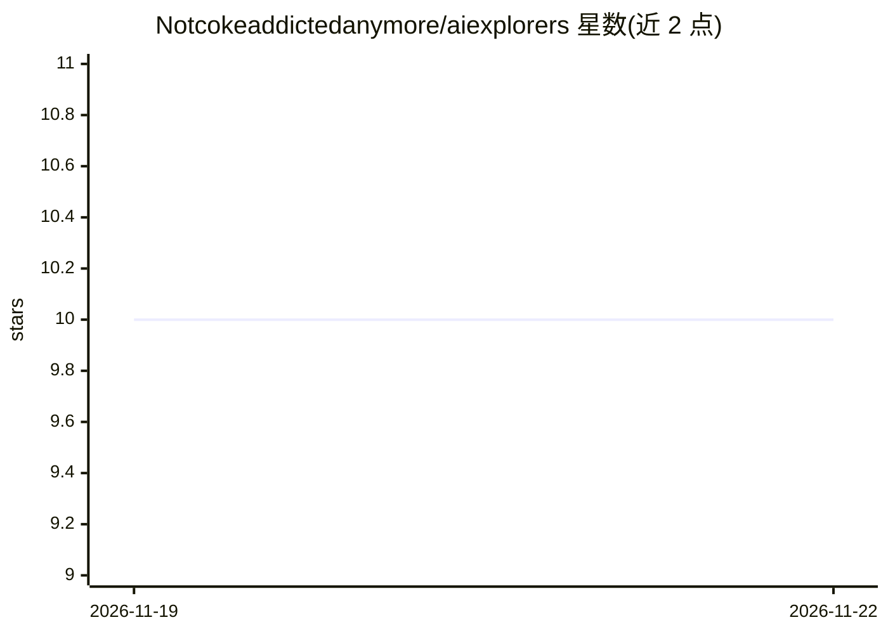

# Notcokeaddictedanymore/aiexplorers

⭐ 10 · HTML · MIT · 推送 2026-06-01 · [GitHub](https://github.com/Notcokeaddictedanymore/aiexplorers) · [官网](https://aiexplorers.cn) · 个人维护 · 中文 README

**中国 K-9 学生的中英双语零代码 AI 素养课程（28 个任务）**

面向中国 4–9 年级学生的零代码 AI 素养课程，7 章 28 个情景化互动任务，涵盖感知、推理、学习、对话、社会、城市 AI 与毕业项目，每关 20–40 分钟，进度保存在浏览器 localStorage。完全前端单文件 HTML 实现，无需安装、服务器或账号，任何可开浏览器的设备即可运行；通过 git clone 获取后直接打开或本地起服务。课程对齐 AI4K12、教育部 2025 通识指南与 UNESCO 框架，由一名 12 岁学生与 Claude 协作设计。

## 筛选速览

| 维度 | 判定 | 备注 |
|---|---|---|
| AI 角色 | `ai-knowledge` | 知识聚合/清单类 |
| 许可风险 | `permissive` | MIT |
| 部署形态 | `None` |  |
| 模型依赖 | — | README 未给出锁定关系 |
| 硬件要求 | — | 无带数字的原话,不猜 |
| 安装摩擦 | `low` | 无编译、无系统依赖或容器化 |
| 成熟度 | — | 结构信号不足 |

## 能力要点

- 7 章 28 个情景化互动任务，中英双语零代码
- 纯单文件 HTML，无构建步骤、无后端、无账号
- M7 毕业关通过 Google Teachable Machine 训练真实模型
- 对齐 AI4K12 Five Big Ideas 与中国教育部 2025 通识指南

## 适用场景

- 给中小学课堂分发即用的 AI 通识课材料
- 孩子在家用浏览器自学 AI 概念
- 学校基于 MIT 许可改编本地化教学版本

## 场景标签

`教程课程` · 领域:学习与行业

## 证据(README 行号)

> L3: > A bilingual, no-code AI literacy course for Chinese K-9 students across 28 hands-on missions.
> L50: 完全前端单文件 HTML，零构建步骤 / Pure single-file HTML, zero build step:

## 星数曲线

2026-11-19 10 → 2026-11-22 10（+0）

---
*卡片 v1 · prompt 1.4 · 生成 2026-11-20 · 置信度 high · 依据 README sha `4e753e5af40c` · [字段定义](../../DATASET.md)*
