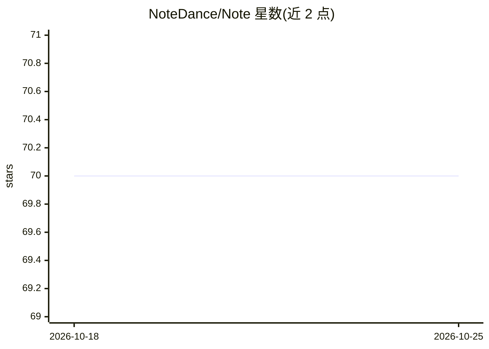

# NoteDance/Note

⭐ 70 · Python · Apache-2.0 · 推送 2026-10-24 · [GitHub](https://github.com/NoteDance/Note) · 个人维护

**基于 TensorFlow/PyTorch 的机器学习库：深度学习与强化学习**

Python 机器学习库 Note，提供神经网络层模块（基于 TensorFlow 实现、兼容其 API，可按 PyTorch 或 Keras 风格搭建网络）、预置模型集合（Note.models.tf）与强化学习训练基类（RL/RL_pytorch，支持用 Note、Keras 或 PyTorch 构建的 agent）。README 还说明参数初始化、Parameter、Sequential 等功能模块，文档与示例放在独立仓库。安装方式为从 GitHub 下载并解压到 site-packages，依赖 TensorFlow、PyTorch、gym、matplotlib、einops，要求 Python≥3.10。

## 筛选速览

| 维度 | 判定 | 备注 |
|---|---|---|
| AI 角色 | `ai-native` | 本体是模型或模型工具 |
| 许可风险 | `permissive` | Apache-2.0 |
| 部署形态 | `None` |  |
| 模型依赖 | — | README 未给出锁定关系 |
| 硬件要求 | — | 无带数字的原话,不猜 |
| 安装摩擦 | `low` | 无编译、无系统依赖或容器化 |
| 成熟度 | — | 结构信号不足 |

## 能力要点

- 基于 TensorFlow 实现的层模块，可按 PyTorch/Keras 风格搭建网络
- RL/RL_pytorch 基类支持训练 Note、Keras 或 PyTorch 构建的 agent
- 预置模型集合兼作使用示例，含训练/测试/保存/恢复与调参流程

## 适用场景

- 用统一接口搭建并训练深度学习模型
- 编写强化学习 agent 并复用训练、保存与恢复流程
- 参考预置模型学习库的用法

## 场景标签

`模型训练` `强化学习` · 领域:训练与推理

## 证据(README 行号)

> L2: Note is an efficient and flexible machine learning library that allows developers to easily build and train neural n
> L24: Note.nn.layer package contains many layer modules, you can use them to build neural networks. Note’s layer modules 

## 星数曲线

2026-10-18 70 → 2026-10-25 70（+0）

---
*卡片 v1 · prompt 1.4 · 生成 2026-10-24 · 置信度 high · 依据 README sha `8b0ca8a101cc` · [字段定义](../../DATASET.md)*
