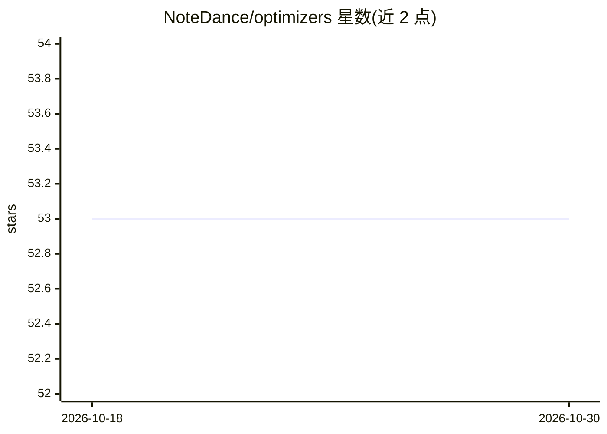

# NoteDance/optimizers

⭐ 53 · Python · Apache-2.0 · 推送 2026-06-19 · [GitHub](https://github.com/NoteDance/optimizers) · 个人维护

**给深度学习研究者的 TensorFlow/Keras 优化器集合**

为 TensorFlow 与 Keras 实现的优化器库，用法与 Keras 优化器一致，包含 AdaBelief、AdamP、LaProp、Lars、MADGRAD、MARS 六种算法。每种优化器均列出完整参数说明与示例代码，支持权重衰减、梯度裁剪、EMA、梯度累积等特性；Lars 面向大批量训练并含 LARC 选项，MARS 支持方差缩减与 AdamW/Lion 两种更新风格。以 Python 模块导入方式使用，README 未给出安装命令。

## 筛选速览

| 维度 | 判定 | 备注 |
|---|---|---|
| AI 角色 | `ai-ecosystem` | LLM/agent 周边工具 |
| 许可风险 | `permissive` | Apache-2.0 |
| 部署形态 | `None` |  |
| 模型依赖 | — | README 未给出锁定关系 |
| 硬件要求 | — | 无带数字的原话,不猜 |
| 安装摩擦 | `medium` | 含编译或系统依赖之一 |
| 成熟度 | — | 结构信号不足 |

## 能力要点

- 6 种优化器：AdaBelief/AdamP/LaProp/Lars/MADGRAD/MARS
- 与 Keras 优化器用法一致，可按 Keras 接口直接调用
- 支持权重衰减、梯度裁剪（norm/value/global）、EMA、梯度累积
- Lars 含 LARC 选项面向大批量训练，MARS 支持 AdamW/Lion 更新风格

## 适用场景

- 在 Keras 训练流程中替换默认优化器进行实验对比
- 大批量训练场景使用 Lars/LARC
- 大规模模型训练尝试 MADGRAD 或 MARS 等算法

## 场景标签

`模型训练` · 领域:训练与推理

## 证据(README 行号)

> L31: import tensorflow as tf
> L5: The `AdaBelief` optimizer is a modification of the Adam optimizer designed to adapt the learning rate to the gradien

## 星数曲线

2026-10-18 53 → 2026-10-30 53（+0）

---
*卡片 v1 · prompt 1.4 · 生成 2026-10-24 · 置信度 mid · 依据 README sha `1c5feac4afc5` · [字段定义](../../DATASET.md)*
