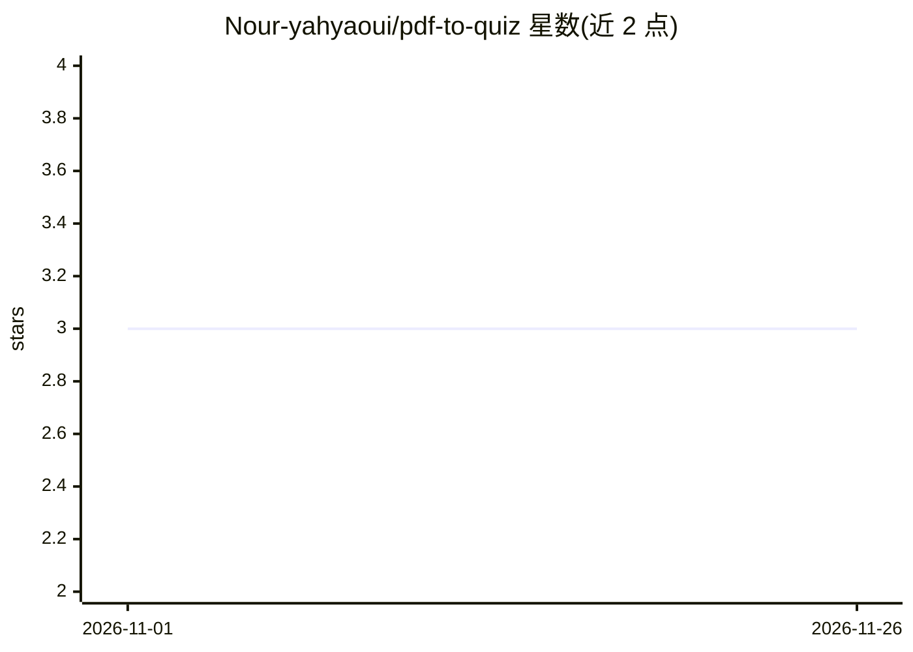

# Nour-yahyaoui/pdf-to-quiz

⭐ 3 · TypeScript · 推送 2026-10-25 · [GitHub](https://github.com/Nour-yahyaoui/pdf-to-quiz) · [官网](https://pdf-to-quiz-neon.vercel.app) · 个人维护

**把 PDF 一键转成 AI 生成的选择题测验的 Web 应用**

Next.js 构建的 Web 应用：上传 PDF（最大 4.5 MB）后选择难度，服务端内存中解析文本并调用 Groq 模型生成十道选择题，按 UUID 链接分享且记录在浏览器本地，无需注册账号。通过 RLS 实现匿名只写一次存储、服务端评分并附答案解析；针对 Groq 免费额度做限流退避并回退到备选模型。需自备 Supabase 与 Groq API key，支持 Vercel 部署。

## 筛选速览

| 维度 | 判定 | 备注 |
|---|---|---|
| AI 角色 | `ai-native` | 本体是模型或模型工具 |
| 许可风险 | `none` | — |
| 部署形态 | `None` |  |
| 模型依赖 | locked-api |  |
| 硬件要求 | — | 无带数字的原话,不猜 |
| 安装摩擦 | `low` | 无编译、无系统依赖或容器化 |
| 成熟度 | — | 结构信号不足 |

## 能力要点

- PDF 上传生成 10 道选择题，支持 easy/medium/hard 三档难度
- 无账号模式：capability URL 分享、浏览器 localStorage 记录
- Groq 免费额度处理：429 退避重试并回退 openai/gpt-oss-20b
- 安全机制：RLS write-once、zod 校验、IP 限流、不存储 PDF

## 适用场景

- 把课件或文档转成选择题自测
- 老师快速从讲义生成课堂小测验
- 无需注册即可创建并分享测验链接

## 场景标签

`文档解析` `AI 写作` · 领域:内容生成

## 证据(README 行号)

> L5: Upload a PDF (max 4.5 MB) and get a ten-question multiple-choice quiz in seconds —
> L13: - **AI:** Groq via `groq-sdk`, with `openai/gpt-oss-20b` fallback and token-limit handling
> L20: 2. The server validates the file, extracts text, and calls Groq with a versioned

## 星数曲线

2026-11-01 3 → 2026-11-26 3（+0）

---
*卡片 v1 · prompt 1.4 · 生成 2026-11-22 · 置信度 high · 依据 README sha `9d3b01420c19` · [字段定义](../../DATASET.md)*
