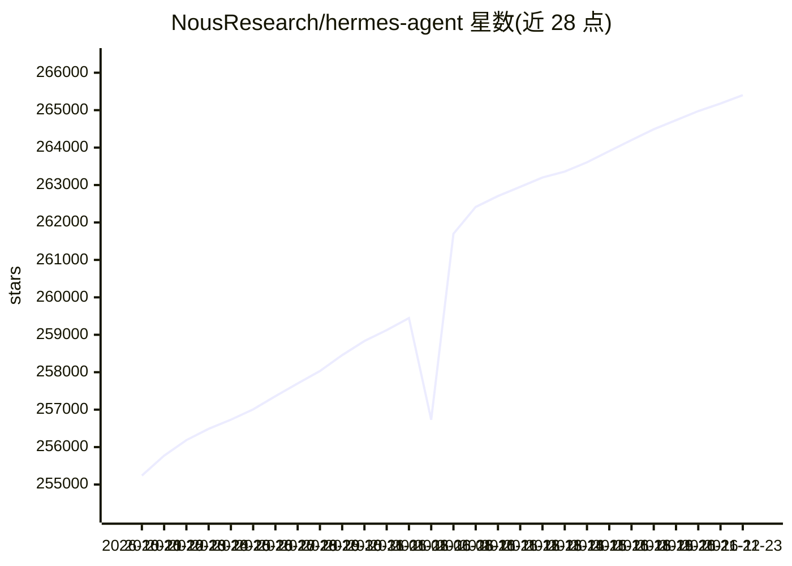

# NousResearch/hermes-agent

⭐ 265,402 · Python · MIT · 推送 2026-11-22 · [GitHub](https://github.com/NousResearch/hermes-agent) · [官网](https://hermes-agent.nousresearch.com) · 组织维护

**可持续学习并跨平台对话的个人 AI agent 运行时**

Nous Research 开发的终端与消息网关形态的 agent：内置学习闭环——从任务经验自动创建技能、使用中自我改进、周期性记忆固化、FTS5 全文检索历史会话并做用户建模。支持 CLI（完整 TUI）与 Telegram/Discord/Slack/WhatsApp/Signal/Email 消息网关两个入口，内置 cron 定时任务、并行子 agent、40+ 工具与 MCP 集成。六种终端后端（本地/Docker/SSH/Modal/Daytona/Vercel Sandbox）可部署到 VPS 或服务器。模型提供方可任意切换，支持从 OpenClaw、Claude Code、Codex CLI、Cursor 导入既有配置与记忆。MIT 许可。

## 筛选速览

| 维度 | 判定 | 备注 |
|---|---|---|
| AI 角色 | `ai-native` | 本体是模型或模型工具 |
| 许可风险 | `permissive` | MIT |
| 部署形态 | `desktop` | 安装包/桌面程序 |
| 模型依赖 | — | README 未给出锁定关系 |
| 硬件要求 | — | 无带数字的原话,不猜 |
| 安装摩擦 | `medium` | 含编译或系统依赖之一 |
| 成熟度 | — | 结构信号不足 |

## 动量与使用信号

- 维护:`active` — 距上次 push 0.6 天,年发版 41,399 位贡献者
- 涨星:近 1 天 **+354**(自 20261016 起算)
- 平台:WINDOWS / MACOS / LINUX / ANDROID · 协议:MCP

## 能力要点

- 学习闭环：自动创建技能、使用中自改进、跨会话记忆与用户建模
- 单网关进程接入 Telegram/Discord/Slack/WhatsApp/Signal 与 CLI，支持语音转写
- 六种终端后端：本地、Docker、SSH、Modal、Daytona、Vercel Sandbox，支持 serverless 休眠
- 可从 OpenClaw/Claude Code/Codex/Cursor 导入设置、记忆与技能

## 适用场景

- 在 VPS 或服务器上常驻一个可跨平台对话的个人 agent
- 用自然语言设置每日报告、夜间备份等定时自动化任务
- 从其他 agent 工具迁移配置、记忆与技能
- 批量生成工具调用轨迹用于训练下一代模型

## 场景标签

`AI 助手` · 领域:对话与助手

## 证据(README 行号)

> L15: **The self-improving AI agent built by Nous Research.** It's the only agent with a built-in learning loop — it crea
> L21:  A closed learning loop Agent-curated memory with periodic nudges. Autonomous skill creation after complex tasks. S
> L19:  A real terminal interface Full TUI with multiline editing, slash-command autocomplete, conversation history, inter

## 星数曲线

2026-10-21 255,238 → 2026-11-23 265,402（+10,164）

---
*卡片 v1 · prompt 1.4 · 生成 2026-11-22 · 置信度 high · 依据 README sha `692d9d2ccfbc` · [字段定义](../../DATASET.md)*
