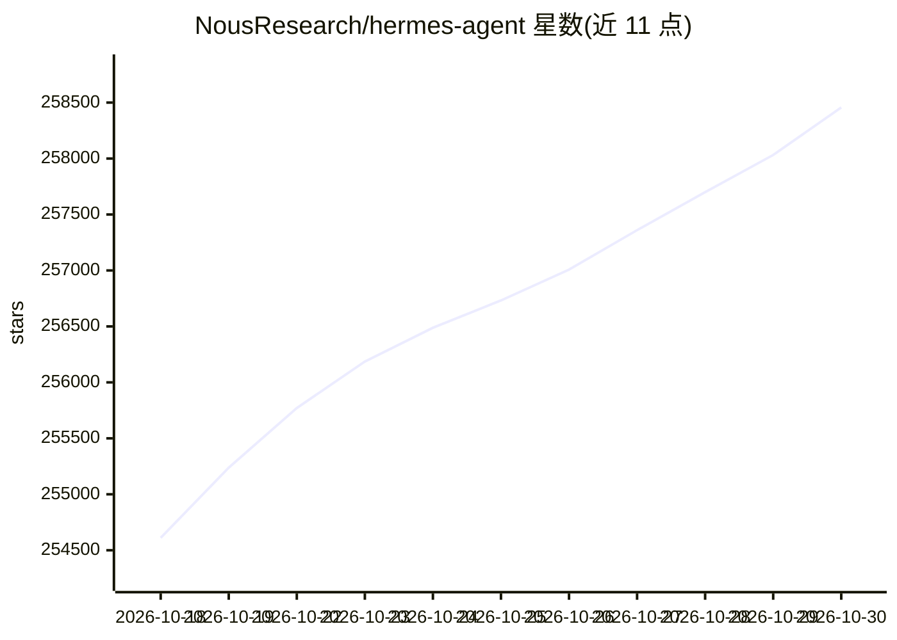

# NousResearch/hermes-agent

⭐ 258,456 · Python · MIT · 推送 2026-10-29 · [GitHub](https://github.com/NousResearch/hermes-agent) · [官网](https://hermes-agent.nousresearch.com) · 组织维护

**自我改进的开源 AI agent，跨 CLI 与消息平台长期陪伴用户**

Nous Research 开发的终端与消息平台 AI agent：内置学习循环，从经验自动创建技能并在使用中改进，持久化记忆与跨会话用户建模（Honcho）。可从 Telegram、Discord、Slack、WhatsApp、Signal、Email 及 CLI 多入口对话，由单一 gateway 进程支撑。支持自选模型供应商（Nous Portal、OpenRouter、OpenAI、自有端点等），`hermes model` 切换。内置 cron 定时任务、子 agent 并行、七种终端后端（本地/Docker/SSH/Modal 等）。提供 Linux/macOS/WSL2 与 Windows 原生一键安装脚本，MIT 许可。

## 筛选速览

| 维度 | 判定 | 备注 |
|---|---|---|
| AI 角色 | `ai-native` | 本体是模型或模型工具 |
| 许可风险 | `permissive` | MIT |
| 部署形态 | `desktop` | 安装包/桌面程序 |
| 模型依赖 | locked-api |  |
| 硬件要求 | — | 无带数字的原话,不猜 |
| 安装摩擦 | `medium` | 含编译或系统依赖之一 |
| 成熟度 | — | 结构信号不足 |

## 动量与使用信号

- 维护:`active` — 距上次 push 0.6 天,年发版 41,399 位贡献者
- 涨星:近 1 天 **+354**(自 20261016 起算)
- 平台:WINDOWS / MACOS / LINUX / ANDROID · 协议:MCP

## 能力要点

- 内置学习循环：经验生成技能、使用中自我改进、跨会话记忆
- Telegram/Discord/Slack/WhatsApp/Signal/Email/CLI 多入口统一 gateway
- 多模型供应商切换（Nous Portal、OpenRouter、OpenAI、自有端点），无锁定
- 七种终端后端，含 Modal/Daytona 等 serverless 持久化环境

## 适用场景

- 通过 Telegram 等消息平台与运行在云端 VM 的 agent 持续对话
- 让 agent 在复杂任务后自动沉淀可复用技能
- 用自然语言设置定时报告、备份等无人值守自动化
- 从 OpenClaw 迁移设置、记忆与技能

## 场景标签

`AI 助手` · 领域:对话与助手

## 证据(README 行号)

> L15: **The self-improving AI agent built by Nous Research.** It's the only agent with a built-in learning loop — it crea
> L17: Use any model you want — Nous Portal, OpenRouter, OpenAI, your own endpoint, and many others. Switch with `hermes m
> L20:  Lives where you do Telegram, Discord, Slack, WhatsApp, Signal, and CLI — all from a single gateway process. Voice 

## 星数曲线

2026-10-18 254,611 → 2026-10-30 258,456（+3,845）

---
*卡片 v1 · prompt 1.4 · 生成 2026-10-20 · 置信度 high · 依据 README sha `35d630817f6c` · [字段定义](../../DATASET.md)*
