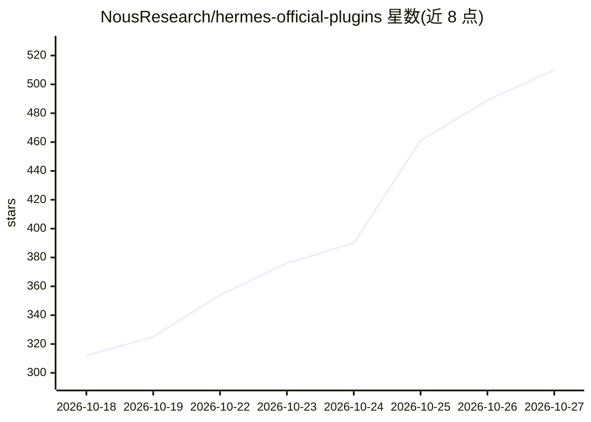

# NousResearch/hermes-official-plugins

⭐ 510 · Python · MIT · 推送 2026-10-26 · [GitHub](https://github.com/NousResearch/hermes-official-plugins) · [官网](https://hermes-agent.nousresearch.com/docs/plugins) · 组织维护

**Hermes Agent 官方插件集：Home Assistant、Spotify、Claude 订阅接入等**

Nous Research 维护的 Hermes Agent 第一方插件仓库，覆盖 Home Assistant 控制、Spotify 播放控制、基于 Claude Code CLI 的订阅制模型提供方、Langfuse 追踪、MCP 服务器、沙箱/容器终端后端、3D 建模、逆向工程等十余个插件。插件经 Hermes 插件目录（plugin catalog）按审阅过的 commit 钉定安装，随自身节奏发版。多数插件原属 Hermes core 或独立仓库，更新后自动迁移，除 MCP Serve 外用户无需额外操作。个别插件标注 experimental。

## 筛选速览

| 维度 | 判定 | 备注 |
|---|---|---|
| AI 角色 | `ai-ecosystem` | LLM/agent 周边工具 |
| 许可风险 | `permissive` | MIT |
| 部署形态 | `None` |  |
| 模型依赖 | locked-api |  |
| 硬件要求 | — | 无带数字的原话,不猜 |
| 安装摩擦 | `low` | 无编译、无系统依赖或容器化 |
| 成熟度 | — | 结构信号不足 |

## 能力要点

- 十余个官方插件：Home Assistant 网关、Spotify 七工具、Claude 订阅 DirectSDK 模型提供方
- 经插件目录安装，条目钉定到已审阅 commit，更新需通过新 pin 审阅
- 含终端沙箱后端（Bubblewrap/Apptainer）与将 Hermes 作为 MCP 服务器的能力
- Agent Importers 一条命令迁移 OpenClaw/Claude Code/Codex/Cursor 配置

## 适用场景

- 为 Hermes Agent 按需安装 Home Assistant、Spotify 等集成
- 用 Claude Pro/Max 订阅而非 API key 驱动 Hermes 模型调用
- 把 Hermes 的会话与工具暴露给 Claude Code/Cursor 等 MCP 客户端

## 场景标签

 · 领域:AI Agent 基础设施/插件

## 证据(README 行号)

> L5:  The official plugins for Hermes Agent, built and maintained by Nous Research.
> L34: The **Hermes plugin catalog** is the reviewed index of everything you can install: model providers, memory provider
> L24: The Hermes core keeps the parts every user needs: the agent loop, memory, skills, the gateway, model routing and th

## 星数曲线

2026-10-18 312 → 2026-10-27 510（+198）

---
*卡片 v1 · prompt 1.4 · 生成 2026-10-21 · 置信度 high · 依据 README sha `baafb87ce888` · [字段定义](../../DATASET.md)*
