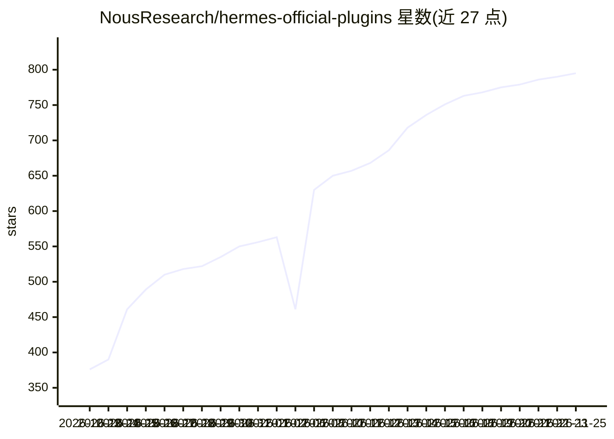

# NousResearch/hermes-official-plugins

⭐ 795 · Python · MIT · 推送 2026-11-21 · [GitHub](https://github.com/NousResearch/hermes-official-plugins) · [官网](https://hermes-agent.nousresearch.com/docs/plugins) · 组织维护

**为 Hermes Agent 提供官方插件目录：接入 Home Assistant、Spotify 等服务**

Nous Research 维护的 Hermes Agent 官方插件合集，经 Hermes 插件目录以固定 commit 分发。核心包含智能体循环、记忆、技能、网关、模型路由与工具运行时；产品/厂商相关功能以插件形式按需安装，涵盖 Home Assistant 设备控制、Spotify 播放、Claude 订阅作为模型后端、Langfuse 追踪、逆向工程、3D 生成、沙箱终端后端、Agent 迁移导入与 MCP 服务输出等。各插件标注所需依赖与账户要求。

## 筛选速览

| 维度 | 判定 | 备注 |
|---|---|---|
| AI 角色 | `ai-ecosystem` | LLM/agent 周边工具 |
| 许可风险 | `permissive` | MIT |
| 部署形态 | `None` |  |
| 模型依赖 | locked-api |  |
| 硬件要求 | — | 无带数字的原话,不猜 |
| 安装摩擦 | `low` | 无编译、无系统依赖或容器化 |
| 成熟度 | — | 结构信号不足 |

## 能力要点

- 一个仓库收录全部官方插件，通过 hermes plugins install 一行安装
- Claude Subscription DirectSDK 插件可经 Claude Code CLI 用 Pro/Max 订阅驱动模型调用
- 提供 OpenClaw/Claude Code/Codex/Cursor 等外部 Agent 配置的一键导入
- 含 Bubblewrap/Singularity 沙箱终端后端与 MCP Serve 服务输出

## 适用场景

- 让 Hermes Agent 控制 Home Assistant 设备并接收通知
- 用 Claude 订阅而非 API key 为 Agent 提供模型
- 把现有 Cursor/Claude Code 等 Agent 配置迁移到 Hermes
- 通过 MCP 让 Claude Code/Cursor 调用 Hermes 的消息与会话能力

## 场景标签

`模型网关` `LLM 可观测性` `Agent 框架` · 领域:Agent 开发

## 证据(README 行号)

> L5:  The official plugins for Hermes Agent, built and maintained by Nous Research.
> L24: The Hermes core keeps the parts every user needs: the agent loop, memory, skills, the gateway, model routing and th
> L34: The **Hermes plugin catalog** is the reviewed index of everything you can install: model providers, memory provider

## 星数曲线

2026-10-23 376 → 2026-11-25 795（+419）

---
*卡片 v1 · prompt 1.4 · 生成 2026-11-24 · 置信度 high · 依据 README sha `4e63df135085` · [字段定义](../../DATASET.md)*
