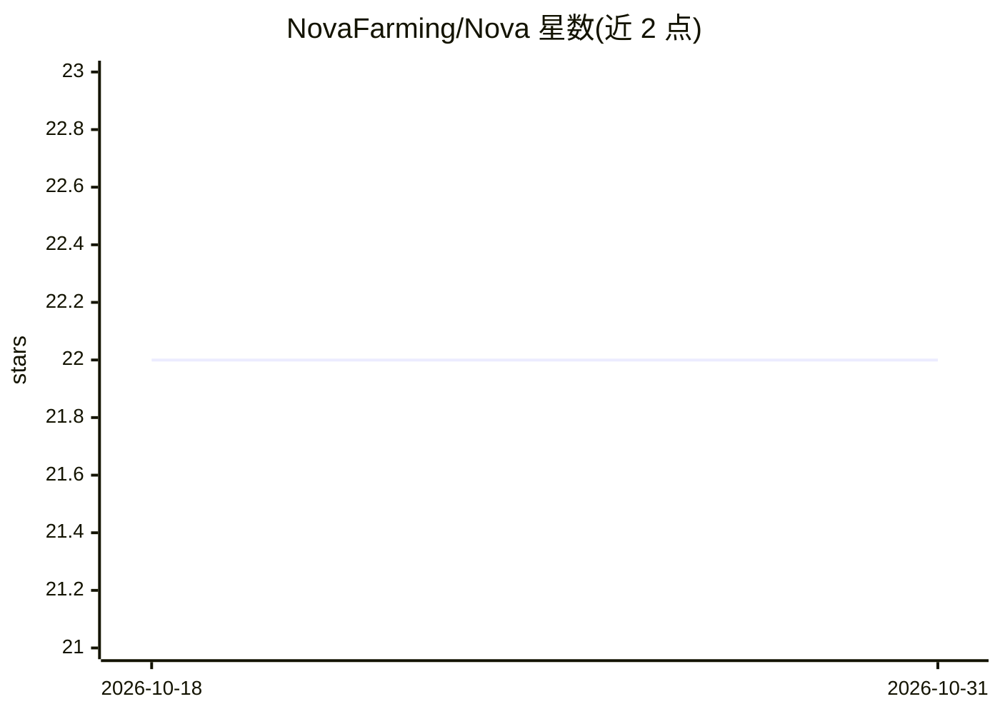

# NovaFarming/Nova

⭐ 22 · TypeScript · 推送 2026-06-22 · [GitHub](https://github.com/NovaFarming/Nova) · 组织维护

**面向 Solana 收益路由的净 APR 分配引擎：Claude agent 生成再平衡方案**

TypeScript 编写的 Solana 收益分配引擎，维护链上收益路由注册表，将毛 APR 分解为费率收益、代币排放、借贷利差、借款成本、IL 拖累与利用率惩罚，按公式计算净 APR；经硬性门槛过滤（最低净 APR、退出深度、集中度上限）后，由 Claude agent 生成考虑集中度的再平衡方案。面向关注已实现收益而非表面收益的操作者。通过 git clone + bun 从源码运行，需配置 ANTHROPIC_API_KEY。

## 筛选速览

| 维度 | 判定 | 备注 |
|---|---|---|
| AI 角色 | `ai-enhanced` | 去掉 AI 部分产品仍成立 |
| 许可风险 | `none` | — |
| 部署形态 | `None` |  |
| 模型依赖 | locked-api |  |
| 硬件要求 | — | 无带数字的原话,不猜 |
| 安装摩擦 | `low` | 无编译、无系统依赖或容器化 |
| 成熟度 | — | 结构信号不足 |

## 能力要点

- 净 APR 公式分解：NetAPR = feeAPR + emissionAPR + lendingCarryAPR - borrowAPR - ILDragAPR - utilizationPenalty
- 硬性门槛：最低净 APR、退出深度过滤、协议集中度上限、摩擦感知再平衡
- Claude allocation loop 生成集中度感知的再平衡方案
- IL 拖累按 IL = 2*sqrt(r)/(1+r)-1 并按已实现波动率缩放估计

## 适用场景

- 把 Solana 资金分配到扣除摩擦后净收益更高的路由
- 过滤无法顺利退出的排放型高收益路由
- 在净优势超过摩擦时才执行再平衡

## 场景标签

`金融量化` · 领域:学习与行业

## 证据(README 行号)

> L13: `Nova` maintains a registry of live Solana yield routes, decomposes gross APR into fee APR, emissions APR, lending 
> L116:   -> claude allocation loop

## 星数曲线

2026-10-18 22 → 2026-10-31 22（+0）

---
*卡片 v1 · prompt 1.4 · 生成 2026-10-28 · 置信度 mid · 依据 README sha `56b7b39bc57c` · [字段定义](../../DATASET.md)*
