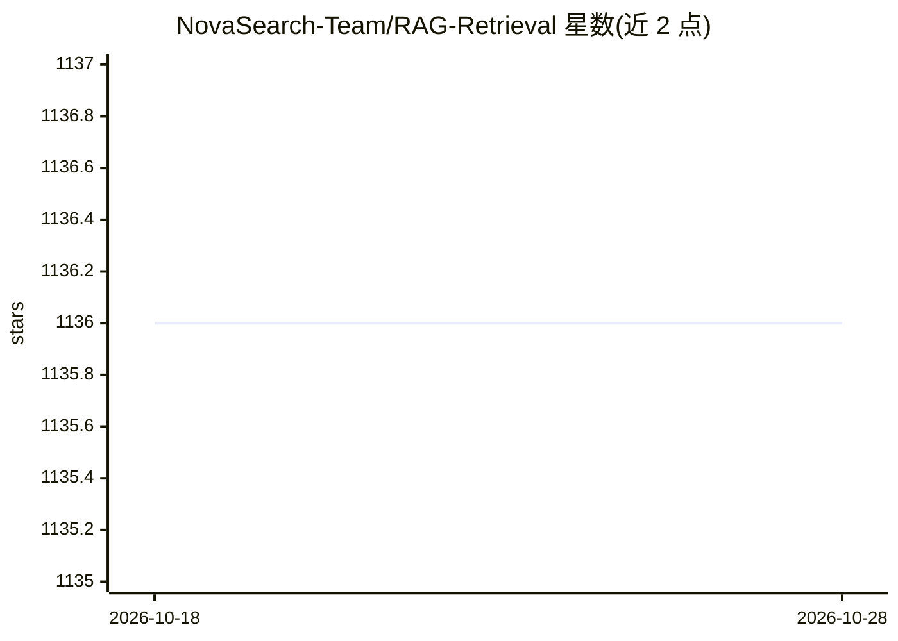

# NovaSearch-Team/RAG-Retrieval

⭐ 1,136 · Python · MIT · 推送 2026-08-28 · [GitHub](https://github.com/NovaSearch-Team/RAG-Retrieval) · 组织维护 · 中文 README

**RAG 检索模型训练/推理/蒸馏代码库，含 reranker 轻量推理库**

提供 RAG 检索模型端到端代码：训练侧支持微调任意开源 RAG 检索模型（embedding、ColBERT、reranker，覆盖 bert-based 与 llm-based），推理侧发布轻量 Python 库 rag-retrieval，以统一接口调用各类排序模型，并支持大模型向小模型（0.5B LLM 或 BERT-base）蒸馏。训练依赖 conda 环境与 requirements.txt 安装，含 deepspeed/fsdp 多卡策略；兼容 bge/bce/gte 系列模型，MIT 许可。

## 筛选速览

| 维度 | 判定 | 备注 |
|---|---|---|
| AI 角色 | `ai-ecosystem` | LLM/agent 周边工具 |
| 许可风险 | `permissive` | MIT |
| 部署形态 | `library` | 以包/库形式分发 |
| 模型依赖 | — | README 未给出锁定关系 |
| 硬件要求 | — | 无带数字的原话,不猜 |
| 安装摩擦 | `medium` | 含编译或系统依赖之一 |
| 成熟度 | — | 结构信号不足 |

## 能力要点

- 支持微调 embedding/ColBERT/reranker 三类开源检索模型
- 轻量库 rag-retrieval 统一调用各类 reranker 模型
- 支持从大模型蒸馏到 0.5B LLM 或 BERT-base 小模型
- 多卡训练策略（deepspeed、fsdp）

## 适用场景

- 用领域数据微调 bge 等 RAG 检索模型
- 在 RAG 流程中以统一接口调用与扩展 reranker
- 将 LLM reranker 蒸馏为小模型以降低部署成本

## 场景标签

`微调` `语义搜索` · 领域:知识与检索

## 证据(README 行号)

> L16: The RAG-Retrieval offers end-to-end code for training, inference, and distillation of the RAG retrieval model.
> L18: - For inference, RAG-Retrieval focuses reranker and has developed a lightweight Python library rag-retrieval, **whi

## 星数曲线

2026-10-18 1,136 → 2026-10-28 1,136（+0）

---
*卡片 v1 · prompt 1.4 · 生成 2026-10-21 · 置信度 high · 依据 README sha `f05dc9e793fb` · [字段定义](../../DATASET.md)*
