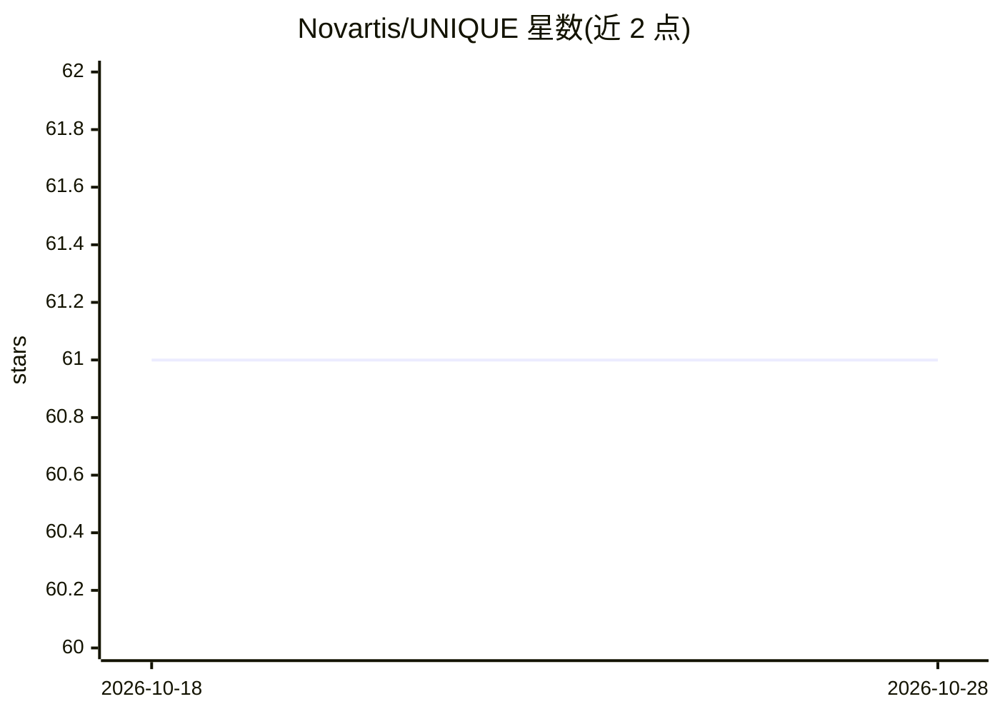

# Novartis/UNIQUE

⭐ 61 · Python · BSD-3-Clause · 推送 2026-10-19 · [GitHub](https://github.com/Novartis/UNIQUE) · [官网](https://opensource.nibr.com/UNIQUE) · 组织维护

**面向机器学习模型预测的不确定性量化基准评测库**

由 Novartis 团队维护的 Python 库，用于量化与评测机器学习模型预测的不确定性：可同时组合多个不确定性量化（UQ）方法进行基准测试，按排序、proper scoring rules、校准三类指标评估，并生成表格与评测图表。工具与模型无关，不依赖特定建模平台，不提供模型训练功能，仅需输入模型的输入与预测。提供 ADME 公共数据集复现脚本，配套 chemRxiv 论文可引用。兼容 Python 3.8–3.12。

## 筛选速览

| 维度 | 判定 | 备注 |
|---|---|---|
| AI 角色 | `ai-ecosystem` | LLM/agent 周边工具 |
| 许可风险 | `permissive` | BSD-3-Clause |
| 部署形态 | `library` | 以包/库形式分发 |
| 模型依赖 | — | README 未给出锁定关系 |
| 硬件要求 | — | 无带数字的原话,不猜 |
| 安装摩擦 | `low` | 无编译、无系统依赖或容器化 |
| 成熟度 | — | 结构信号不足 |

## 能力要点

- 同时组合与基准测试多种不确定性量化方法
- 三类评测（排序/proper scoring rules/校准）指标输出
- 模型无关：仅需模型输入与预测，不提供训练功能
- 生成表格与评测图表，附 ADME 公共数据集复现示例

## 适用场景

- 为我训练的 ML 模型预测结果做不确定性量化和对比评测
- 在分子性质预测等场景下评估 UQ 方法在数据偏移下的表现
- 生成 UQ 方法的可视化评测报告

## 场景标签

`模型评测` · 领域:评测与运维

## 证据(README 行号)

> L3:  <figcaption align=center><u> UN </u>certa<u> I </u>nty <u> QU </u>antification b<u> E </u>nchmark: a Python library
> L18: `UNIQUE` provides methods for quantifying and evaluating the uncertainty of Machine Learning (ML) models prediction
> L20: `UNIQUE` is a model-agnostic tool, meaning that it does not depend on any specific ML model building platform or pr

## 星数曲线

2026-10-18 61 → 2026-10-28 61（+0）

---
*卡片 v1 · prompt 1.4 · 生成 2026-10-24 · 置信度 high · 依据 README sha `875f9b17ed92` · [字段定义](../../DATASET.md)*
