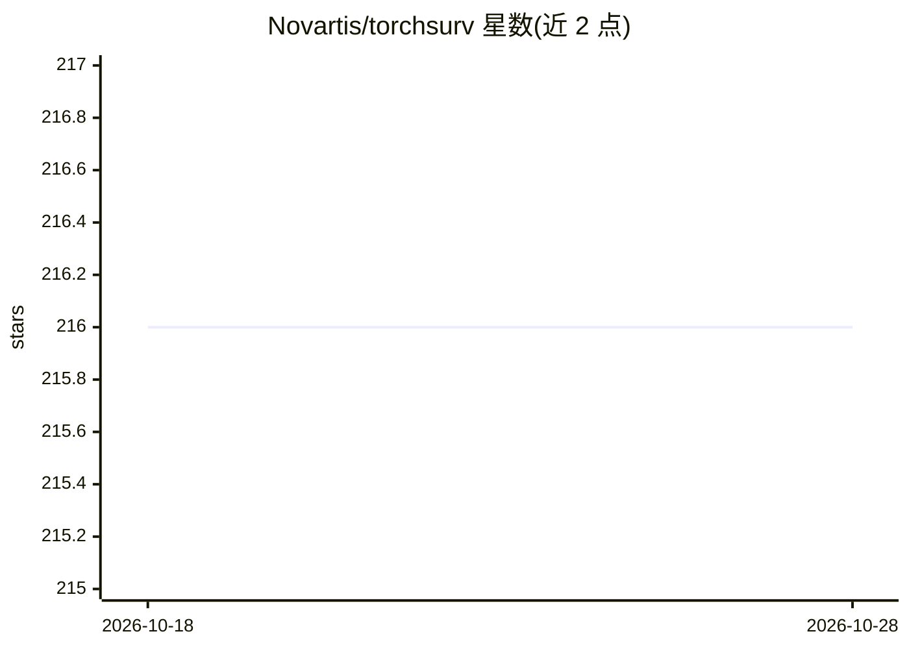

# Novartis/torchsurv

⭐ 216 · Python · MIT · 推送 2026-10-28 · [GitHub](https://github.com/Novartis/torchsurv) · [官网](http://opensource.nibr.com/torchsurv/) · 组织维护

**PyTorch 生态的深度生存分析工具包，供自定义神经生存模型使用**

由 Novartis 与美国 FDA 合作开发的 Python 库，在 PyTorch 环境内提供深度生存建模所需的损失函数（Cox 偏似然、Weibull AFT 等）与评估指标（concordance index、AUC、Brier score 等）。用户自带任意 PyTorch 神经网络输出所需参数，TorchSurv 以普通函数形式计算损失与指标，不施加特定参数化形式，适配高维输入场景。已列入 PyTorch Ecosystem 与 FDA 监管科学工具目录，发布于 PyPI 与 conda-forge。

## 筛选速览

| 维度 | 判定 | 备注 |
|---|---|---|
| AI 角色 | `ai-ecosystem` | LLM/agent 周边工具 |
| 许可风险 | `permissive` | MIT |
| 部署形态 | `library` | 以包/库形式分发 |
| 模型依赖 | — | README 未给出锁定关系 |
| 硬件要求 | — | 无带数字的原话,不猜 |
| 安装摩擦 | `low` | 无编译、无系统依赖或容器化 |
| 成熟度 | — | 结构信号不足 |

## 能力要点

- 提供 Cox 与 Weibull AFT 等生存损失函数
- 提供 concordance index、AUC、Brier score 等生存评估指标
- 100% PyTorch 后端，用户可自定义任意神经网络架构
- 输出与 Python/R 基准包做过数值对比验证

## 适用场景

- 用自定义 PyTorch 神经网络拟合 Cox 比例风险模型
- 高维数据（如放射基因组学）场景下的生存建模
- 生存模型的训练损失计算与预测性能评估

## 场景标签

`模型训练` `模型评测` · 领域:评测与运维

## 证据(README 行号)

> L19: `TorchSurv` is a Python package that serves as a companion tool to perform deep survival modeling within the `PyTor
> L27: Our idea is to **keep things simple**. You are free to use any model architecture you want! Our code has 100% PyTor

## 星数曲线

2026-10-18 216 → 2026-10-28 216（+0）

---
*卡片 v1 · prompt 1.4 · 生成 2026-10-22 · 置信度 high · 依据 README sha `89950975075c` · [字段定义](../../DATASET.md)*
