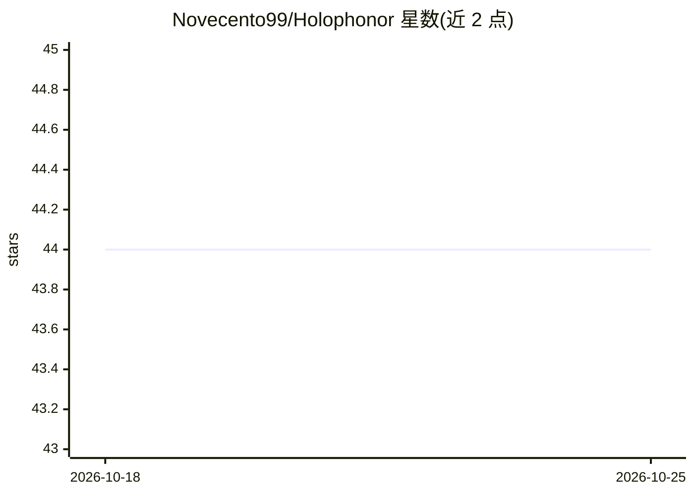

# Novecento99/Holophonor

⭐ 44 · Jupyter Notebook · MIT · 推送 2026-04-03 · [GitHub](https://github.com/Novecento99/Holophonor) · [官网](https://github.com/Novecento99/LiuMotion) · 个人维护

**实时音频信号驱动神经网络生成图像的软件**

通过 UDP 连接接收数据（如来自改版 Friture 的实时音频分析），将数据输入神经网络（默认 Google DeepMind BigGAN，含 1000 类别）实时生成并显示图像。LiuNet 类封装模型加载，便于替换不同模型与输入源。提供 Windows 可执行文件供非开发者直接运行（自动下载 BigGAN 模型），也可从 Python 源码运行；开发者路径需安装依赖，可选 CUDA 驱动提升性能。附多硬件 FPS/延迟基准数据。

## 筛选速览

| 维度 | 判定 | 备注 |
|---|---|---|
| AI 角色 | `ai-native` | 本体是模型或模型工具 |
| 许可风险 | `permissive` | MIT |
| 部署形态 | `desktop` | 安装包/桌面程序 |
| 模型依赖 | — | README 未给出锁定关系 |
| 硬件要求 | — | 无带数字的原话,不猜 |
| 安装摩擦 | `medium` | 含编译或系统依赖之一 |
| 成熟度 | — | 结构信号不足 |

## 能力要点

- UDP 接收实时数据并驱动神经网络生成图像
- 默认使用 Google DeepMind BigGAN（1000 类别），模型启动时自动下载
- LiuNet 封装层支持替换不同模型与输入数据源
- 提供 Windows 可执行版本与多硬件性能基准

## 适用场景

- 现场音乐演出中随音频实时生成可视化画面
- 为音乐视频生成与音轨同步的动态视觉
- 为游戏或音乐练习创建响应输入的交互可视化

## 场景标签

`图像生成` · 领域:内容生成

## 证据(README 行号)

> L11: Holophonor is a software that generates images in real time. It leverages neural networks (a subset of the artifici
> L16: The software listens for data from an UDP connection. When received, it parses the data and feed it to the AI model

## 星数曲线

2026-10-18 44 → 2026-10-25 44（+0）

---
*卡片 v1 · prompt 1.4 · 生成 2026-10-25 · 置信度 mid · 依据 README sha `7cabdf263b0e` · [字段定义](../../DATASET.md)*
