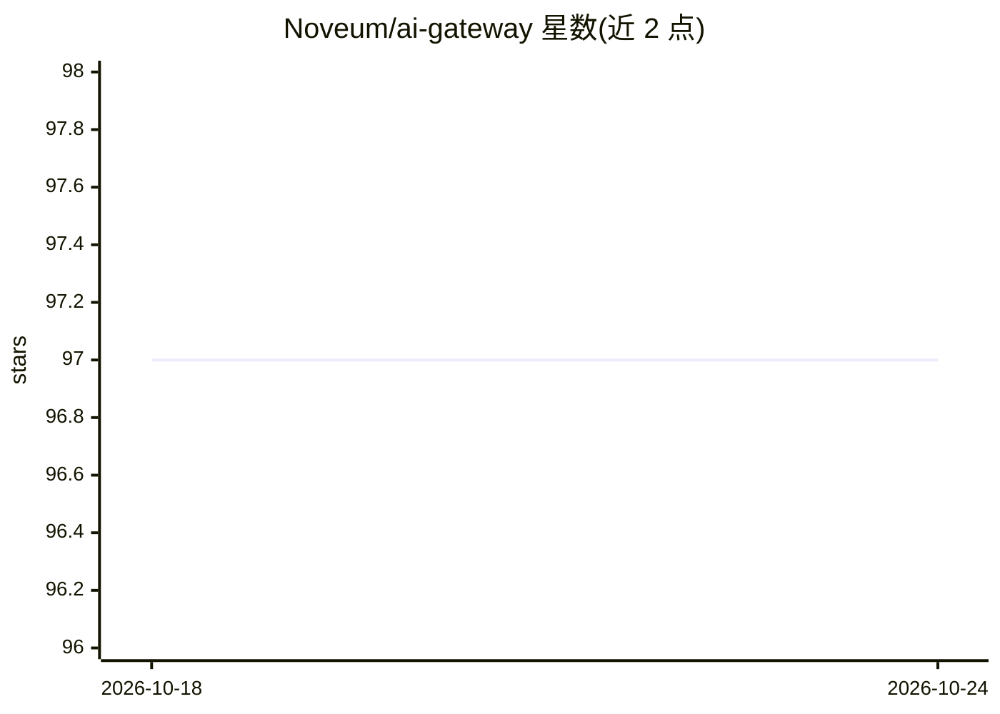

# Noveum/ai-gateway

⭐ 97 · Rust · Apache-2.0 · 推送 2026-09-30 · [GitHub](https://github.com/Noveum/ai-gateway) · [官网](https://noveum.ai) · 组织维护

**Rust 编写的 OpenAI 兼容多供应商 AI 网关**

用 Rust 实现的 API 网关，对外暴露单一 OpenAI Chat Completions 接口，通过 x-provider 头切换上游（OpenAI、Anthropic、Groq、Fireworks、Together、AWS Bedrock 及 Mistral/Cohere/Gemini/DeepSeek/xAI/OpenRouter/Perplexity 等兼容路由）。提供流式与缓冲响应转换、按版本定价目录的 token/缓存/长上下文费用核算，以及本地或平台管理的 Nova Guard 策略（正则、PII、密钥、schema 等限制）。部署形态含原生二进制、Docker、Rust 库与 Cloudflare Worker。面向搭建 LLM 接入层的开发者与团队；限制包括：需 Rust 1.94.1+，透明/专属模式本身不提供客户端认证，各供应商功能不一致，2.x 相对 1.x 有 SemVer-major API 变更。

## 筛选速览

| 维度 | 判定 | 备注 |
|---|---|---|
| AI 角色 | `ai-ecosystem` | LLM/agent 周边工具 |
| 许可风险 | `permissive` | Apache-2.0 |
| 部署形态 | `self-host` | docker 或自建部署 |
| 模型依赖 | locked-api |  |
| 硬件要求 | — | 无带数字的原话,不猜 |
| 安装摩擦 | `low` | 无编译、无系统依赖或容器化 |
| 成熟度 | — | 结构信号不足 |

## 能力要点

- 单一 OpenAI 兼容接口通过 x-provider 切换 10+ 上游供应商
- 版本化定价目录：token、缓存、长上下文与工具费用核算
- Nova Guard 策略引擎：本地无状态或平台管理模式，含正则/PII/密钥/allowlist 策略
- 四种部署形态：原生二进制、Docker、Rust 库、Cloudflare Worker

## 适用场景

- 统一多个 LLM 供应商的接入接口并做成本核算
- 在网关层执行 PII、密钥泄露与 allowlist 策略
- 将 Anthropic Messages 与 Bedrock Converse 流转换为 OpenAI 格式
- 以 Docker/Kubernetes 或 Cloudflare Worker 形式部署网关

## 场景标签

`模型网关` · 领域:Agent 开发

## 证据(README 行号)

> L3: An OpenAI-compatible, multi-provider AI gateway written in Rust, with streaming,
> L19: The gateway exposes one OpenAI Chat Completions surface. Select an upstream with
> L22: - OpenAI, Anthropic, Groq, Fireworks, Together AI, and AWS Bedrock;

## 星数曲线

2026-10-18 97 → 2026-10-24 97（+0）

---
*卡片 v1 · prompt 1.4 · 生成 2026-10-23 · 置信度 high · 依据 README sha `5b482329716c` · [字段定义](../../DATASET.md)*
