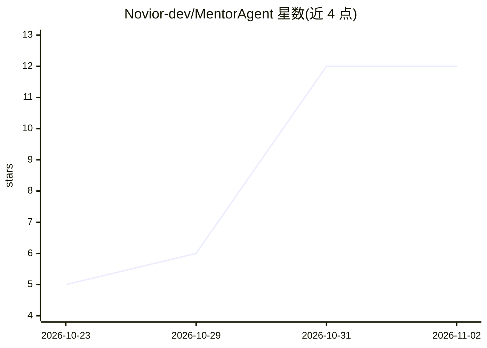

# Novior-dev/MentorAgent

⭐ 12 · C# · Apache-2.0 · 推送 2026-10-27 · [GitHub](https://github.com/Novior-dev/MentorAgent) · [官网](https://mentoragent.net/) · 组织维护

**为 .NET 应用接入 AI agent 的框架：方法变工具并带权限与人工确认**

基于 Microsoft Agent Framework 的 .NET 库，将应用中的方法注册为 agent 可调用的工具，附带角色权限检查与用户在聊天组件中确认后执行的人工介入机制。提供 Blazor/MAUI 现成聊天组件，也可通过 SignalR、SSE、MCP 或 A2A 接入任意前端；支持任何实现 IChatClient 的提供方（Azure OpenAI、OpenAI、Ollama 等），并可用 YAML 声明式定义专家 agent。以 NuGet 包分发，Apache-2.0 许可。

## 筛选速览

| 维度 | 判定 | 备注 |
|---|---|---|
| AI 角色 | `ai-ecosystem` | LLM/agent 周边工具 |
| 许可风险 | `permissive` | Apache-2.0 |
| 部署形态 | `None` |  |
| 模型依赖 | local-ok | 支持本地模型 |
| 硬件要求 | — | 无带数字的原话,不猜 |
| 安装摩擦 | `medium` | 含编译或系统依赖之一 |
| 成熟度 | — | 结构信号不足 |

## 能力要点

- 方法→工具注册，带角色检查与人工确认（human-in-the-loop）
- Blazor/MAUI 现成聊天组件，SignalR/SSE/MCP/A2A 接任意前端
- 兼容任何 IChatClient 提供方（Azure OpenAI/OpenAI/Ollama 等）
- YAML 声明式定义专家 agent 的独立包

## 适用场景

- 在 Blazor 或 MAUI 应用里加一个能调用业务方法的 AI 助手
- 让敏感操作（如取消订单）只对特定角色开放并需用户确认
- 把现有 Web API 或后端封装为 MCP server 或 A2A agent

## 场景标签

`Agent 框架` · 领域:Agent 开发

## 证据(README 行号)

> L7: Add AI agents to your .NET app: your methods become tools with role checks and human confirmation.
> L9: Built on Microsoft Agent Framework, with any provider that offers an `IChatClient`: Azure OpenAI, OpenAI, Ollama and

## 星数曲线

2026-10-23 5 → 2026-11-02 12（+7）

---
*卡片 v1 · prompt 1.4 · 生成 2026-11-01 · 置信度 high · 依据 README sha `4fee90a09eb1` · [字段定义](../../DATASET.md)*
