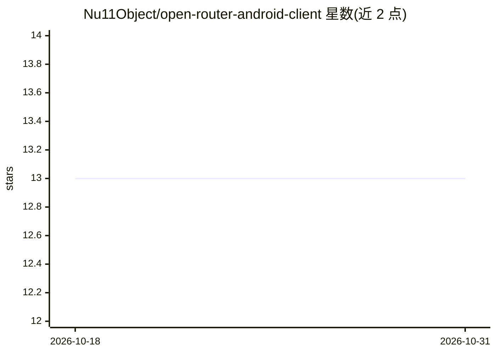

# Nu11Object/open-router-android-client

⭐ 13 · Kotlin · MIT · 推送 2026-10-20 · [GitHub](https://github.com/Nu11Object/open-router-android-client) · 个人维护

**通过 OpenRouter 调用 AI 模型的 Android 聊天客户端（教学项目）**

Kotlin 编写的 Android 应用，通过 OpenRouter API 发送请求并获取模型回复，支持从模型目录选择并收藏模型、切换是否携带聊天历史的上下文模式、以会话形式保存消息历史、使用自定义 API key 与清空记录。架构采用 Clean Architecture 分层与 MVVM（ViewModel+Flow），Room 存储历史、Retrofit2 网络请求、Hilt 依赖注入。README 声明项目已停止维护，开发迁移至 void-openrouter-client 仓库。需自行编译运行并配置 OpenRouter API key。

## 筛选速览

| 维度 | 判定 | 备注 |
|---|---|---|
| AI 角色 | `ai-native` | 本体是模型或模型工具 |
| 许可风险 | `permissive` | MIT |
| 部署形态 | `None` |  |
| 模型依赖 | locked-api |  |
| 硬件要求 | — | 无带数字的原话,不猜 |
| 安装摩擦 | `low` | 无编译、无系统依赖或容器化 |
| 成熟度 | — | 结构信号不足 |

## 能力要点

- 通过 OpenRouter API 与模型对话，支持自定义 API key
- 收藏模型、上下文模式切换、会话历史保存（Room）
- Clean Architecture + MVVM，Hilt/Retrofit2/Flow 技术栈

## 适用场景

- 在 Android 设备上通过 OpenRouter 使用 AI 模型
- 学习 Android Clean Architecture 与 MVVM 实践
- 多模型切换并保留聊天记录

## 场景标签

`聊天机器人` · 领域:对话与助手

## 证据(README 行号)

> L14: **OpenRouter::client** — Android application for communicating with neural networks via the OpenRouter.ai service. 
> L18: * Sending requests to a neural network through the OpenRouter API

## 星数曲线

2026-10-18 13 → 2026-10-31 13（+0）

---
*卡片 v1 · prompt 1.4 · 生成 2026-10-31 · 置信度 high · 依据 README sha `94bd4264a58b` · [字段定义](../../DATASET.md)*
