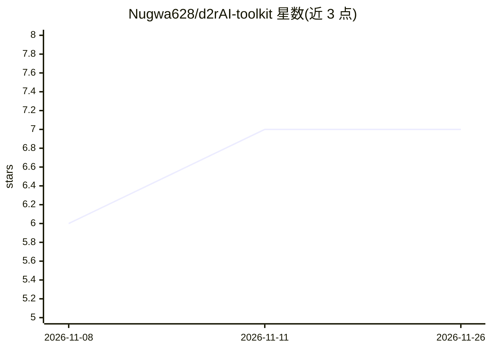

# Nugwa628/d2rAI-toolkit

⭐ 7 · Python · MIT · 推送 2026-11-25 · [GitHub](https://github.com/Nugwa628/d2rAI-toolkit) · 个人维护

**用 AI agent 构建与移植 D2R 引擎级模组的工具包**

面向 Diablo II: Resurrected 模组作者的 AI 工作台：通过 Claude Code 等 agent 对接一组配套资源——D2RLoader 引擎插件模板、93847 地址表、Ghidra 脚本、modkit（JSON 补丁构建与校验模组文件夹）、引擎知识库与分任务 skills。功能覆盖数据 mod、引擎级改动、老模组移植、游戏副本自动化测试、发布打包（7z+manifest、Nexus 归档）与多 agent 并行工作流。要求 Windows、已安装 D2R 3.3、Python 3.12+、VS C++ 工作负载与 PATH 上的 CMake；仅读取用户本机游戏文件，不入库。

## 筛选速览

| 维度 | 判定 | 备注 |
|---|---|---|
| AI 角色 | `ai-enhanced` | 去掉 AI 部分产品仍成立 |
| 许可风险 | `permissive` | MIT |
| 部署形态 | `desktop` | 安装包/桌面程序 |
| 模型依赖 | — | README 未给出锁定关系 |
| 硬件要求 | — | 无带数字的原话,不猜 |
| 安装摩擦 | `medium` | 含编译或系统依赖之一 |
| 成熟度 | — | 结构信号不足 |

## 能力要点

- modkit 将小体积 JSON 补丁构建为完整模组文件夹并校验（0 errors 检查）
- Ghidra 脚本与 93847 地址注册表定位引擎 hook
- 游戏槽位副本中的自动化测试、截图命名检查
- coordinator + lanes 的多 agent 并行工作流模板与 pre-commit 泄漏扫描

## 适用场景

- 用自然语言描述新游戏系统，agent 规划并实现数据与插件
- 在原作者许可下把 1.10/1.13c 时代模组移植到 D2R
- 把玩家崩溃报告转化为函数定位与修复
- 通过 AI 对话快速生成装备、技能等数据改动

## 场景标签

`编码 Agent` · 领域:编码与开发

## 证据(README 行号)

> L25: **d2rAI-toolkit** lets you change **Diablo II: Resurrected** at the engine level by talking to an AI coding agent
> L31: It gives the agent everything it needs to work safely on D2R:
> L97: You need Windows, an installed D2R 3.3, Python 3.12+, git, and Visual Studio with the C++ workload

## 星数曲线

2026-11-08 6 → 2026-11-26 7（+1）

---
*卡片 v1 · prompt 1.4 · 生成 2026-11-20 · 置信度 high · 依据 README sha `f576df97e4ed` · [字段定义](../../DATASET.md)*
