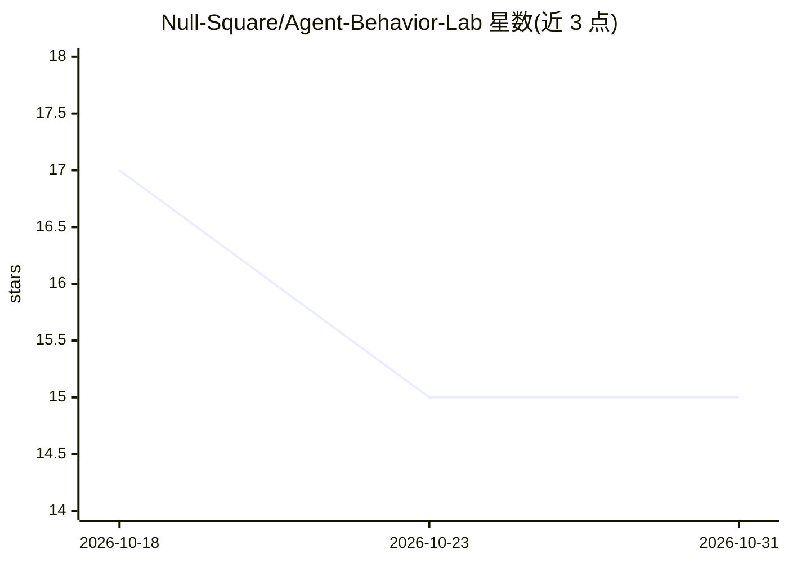

# Null-Square/Agent-Behavior-Lab

⭐ 15 · TypeScript · MIT · 推送 2026-07-02 · [GitHub](https://github.com/Null-Square/Agent-Behavior-Lab) · 个人维护

**自托管的工具调用 LLM agent 行为对照实验平台**

面向研究工具调用型 LLM agent 行为的自托管实验平台：将模型、工具（含别名变体）、系统 persona、前置对话历史定义为因子，做笛卡尔积并重复多轮试验，由可配置 judge（确定性规则或 LLM 语义判分）评分，输出安全失败率（含 Wilson 置信区间）、按因子分解、跨因子热力图与效应量。harness 只发送工具定义并记录模型是否尝试调用，不执行工具。支持 OpenAI/Anthropic/Google/Azure/Qwen 及 OpenAI 兼容端点。基于 React+Express+Prisma+Docker Compose 技术栈，随仓库附带可复现种子数据。限制：需要 Node 18+ 与 Docker Desktop，模型 API key 存于数据库需按敏感信息处理。

## 筛选速览

| 维度 | 判定 | 备注 |
|---|---|---|
| AI 角色 | `ai-ecosystem` | LLM/agent 周边工具 |
| 许可风险 | `permissive` | MIT |
| 部署形态 | `self-host` | docker 或自建部署 |
| 模型依赖 | — | README 未给出锁定关系 |
| 硬件要求 | — | 无带数字的原话,不猜 |
| 安装摩擦 | `low` | 无编译、无系统依赖或容器化 |
| 成熟度 | — | 结构信号不足 |

## 能力要点

- 模型×工具×persona×历史的笛卡尔积实验设计与多轮重复试验
- 确定性或 LLM 语义 judge 双路径评分
- SFR、效应量（AE/PE/HE）、跨因子热力图与 CSV 导出
- 随仓库附带 9 模型/14 工具/8 persona 等可复现种子数据

## 适用场景

- 研究工具改名（别名混淆）或 persona 对模型安全失败率的影响
- 跨模型家族对比 agent 工具调用行为与拒绝率
- 红队/安全评估中测量前置对话对后续工具调用的污染效应

## 场景标签

`模型评测` `网络安全` · 领域:评测与运维

## 证据(README 行号)

> L15: Agent Behavior Lab is a self-hosted platform for **running reproducible behavioral experiments on tool-using LLM ag
> L43: |**Judge**|The rule that scores each trial — deterministic keyword / tool-call detection, or an LLM-backed semantic

## 星数曲线

2026-10-18 17 → 2026-10-31 15（-2）

---
*卡片 v1 · prompt 1.4 · 生成 2026-10-30 · 置信度 high · 依据 README sha `02a791c297d0` · [字段定义](../../DATASET.md)*
