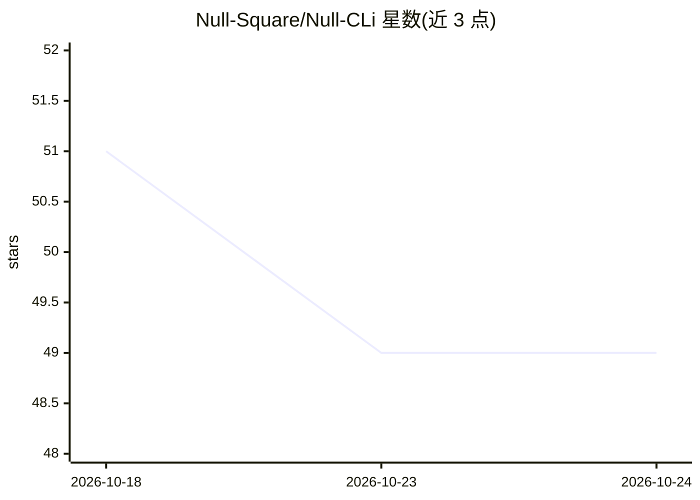

# Null-Square/Null-CLi

⭐ 49 · TypeScript · NOASSERTION · 推送 2026-07-03 · [GitHub](https://github.com/Null-Square/Null-CLi) · [官网](https://nullsquare.net) · 组织维护

**面向授权测试的开源 AI 渗透测试与合规就绪 CLI**

NullSquare 开源的终端安全工具：以单 agent 循环对授权目标执行侦察、扫描编排、证据留存与发现报告，输出 Markdown 与 SARIF 2.1.0 报告，并将发现映射到 OWASP Top 10、PCI DSS lite、ISO 27001 lite、NIST CSF lite 合规就绪框架。支持多模型配置（OpenAI/DeepSeek/Anthropic/GLM/Moonshot/Qwen），API key 本地加密存储；扫描与 shell 执行默认关闭，需显式授权开启。深度漏洞验证等保留在商业托管平台，本仓库仅含开源框架层。

## 筛选速览

| 维度 | 判定 | 备注 |
|---|---|---|
| AI 角色 | `ai-native` | 本体是模型或模型工具 |
| 许可风险 | `none` | NOASSERTION |
| 部署形态 | `self-host` | docker 或自建部署 |
| 模型依赖 | locked-api |  |
| 硬件要求 | — | 无带数字的原话,不猜 |
| 安装摩擦 | `low` | 无编译、无系统依赖或容器化 |
| 成熟度 | — | 结构信号不足 |

## 能力要点

- scoped 单 agent 循环：每轮一个安全动作、硬边界 scope、证据优先报告
- 归一化 nuclei/semgrep/trivy 扫描结果为统一发现
- 发现映射 OWASP/PCI DSS/ISO 27001/NIST CSF 就绪框架（非认证）
- Docker 沙箱运行时含 httpx/nuclei/nmap/semgrep/trivy 等工具链

## 适用场景

- 对自己的训练靶场（JuOWASP Juice Shop/WebGoat）跑 demo 评估并生成报告
- 把 nuclei/semgrep/trivy 扫描输出归一化为统一发现与 SARIF
- 授权范围内做渗透测试发现项的合规就绪映射
- CI 中以 dry-run 模式做无侵入评估

## 场景标签

`网络安全` · 领域:学习与行业

## 证据(README 行号)

> L17: A scoped terminal agent for authorized testing: safe reconnaissance, scanner orchestration, evidence-backed finding
> L25: Modern teams need security feedback that is faster than a traditional pentest and more useful than raw scanner outp

## 星数曲线

2026-10-18 51 → 2026-10-24 49（-2）

---
*卡片 v1 · prompt 1.4 · 生成 2026-10-24 · 置信度 high · 依据 README sha `8d9dcd5d3799` · [字段定义](../../DATASET.md)*
