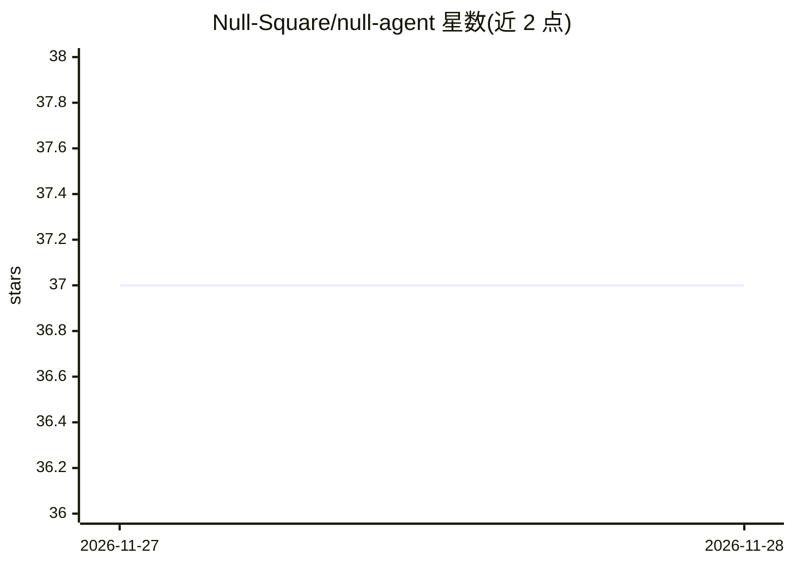

# Null-Square/null-agent

⭐ 37 · TypeScript · Apache-2.0 · 推送 2026-11-26 · [GitHub](https://github.com/Null-Square/null-agent) · [官网](https://nullsquare.net) · 组织维护

**给安全测试者的本地 AI 渗透测试 agent：规划测试并生成报告**

Null AI 是可在本地运行的 AI 渗透测试平台，提供 Pentest、Code Review、Compliance 三类任务：agent 在密封 Docker 沙箱内使用 55 个安全工具（nmap、nuclei、sqlmap 等）与 108 个技能执行侦察、枚举与测试，发现需经独立验证步骤证明后才成立，并保留证据、生成可本地渲染为 PDF 的报告。模型由用户自选（ChatGPT 登录、Claude API key 或其他 provider）。合规模块支持 SOC 2、ISO 27001、NIST CSF 等就绪度评审。应用仅监听 127.0.0.1，数据存储在本地 Postgres。

## 筛选速览

| 维度 | 判定 | 备注 |
|---|---|---|
| AI 角色 | `ai-native` | 本体是模型或模型工具 |
| 许可风险 | `permissive` | Apache-2.0 |
| 部署形态 | `self-host` | docker 或自建部署 |
| 模型依赖 | local-ok | 支持本地模型 |
| 硬件要求 | — | 无带数字的原话,不猜 |
| 安装摩擦 | `low` | 无编译、无系统依赖或容器化 |
| 成熟度 | — | 结构信号不足 |

## 能力要点

- agent 在密封沙箱中使用 55 个工具（nmap/nuclei/sqlmap/ffuf/semgrep/trivy 等）
- 108 个技能覆盖 JWT 攻击、IDOR、请求走私、GraphQL、OAuth、云与 Kubernetes
- 发现须经独立验证步骤证明，报告含证据并本地渲染 PDF
- 合规就绪度评审支持 SOC 2、ISO 27001、NIST CSF、PCI DSS、HIPAA、GDPR

## 适用场景

- 对自己拥有或获授权的网站执行自动化渗透测试
- 结合本地代码目录或 git 仓库做白盒测试与代码审查
- 依据自有证据做 SOC 2 / ISO 27001 等合规就绪度评审
- 用内置 OWASP Juice Shop 练习环境学习渗透流程

## 场景标签

`网络安全` `代码审查` · 领域:编码与开发

## 证据(README 行号)

> L3: **The open-source AI pentester.** Null AI plans the test, runs real security tools in a sealed sandbox, proves what 
> L15: - **Pentest.** Maps the attack surface, then tests it the way a person would: recon, enumeration, then the weakness
> L41: Settings, Model: Continue with ChatGPT, Claude with an API key, or another provider

## 星数曲线

2026-11-27 37 → 2026-11-28 37（+0）

---
*卡片 v1 · prompt 1.4 · 生成 2026-11-27 · 置信度 high · 依据 README sha `9f3bf49eeeb0` · [字段定义](../../DATASET.md)*
