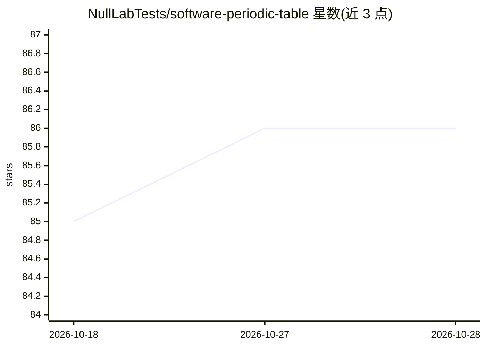

# NullLabTests/software-periodic-table

⭐ 86 · TypeScript · MIT · 推送 2026-10-17 · [GitHub](https://github.com/NullLabTests/software-periodic-table) · 个人维护

**115 个软件构件本体：供编码 agent 检索与组装的元素表**

面向 LLM 编码 agent 的数据工件与组装框架：将应用软件拆解为 115 个跨 6 个家族（Objects/Properties/Actions/Interfaces/Intelligence/Rules）的有限元素，以 JSON 本体（含 JSON Schema 与校验器）为唯一事实源，配套严格 TypeScript 参考实现、组合系统提示词与评测 harness。使用方式为检索增强或直接注入提示词。README 明确撤回了此前的 39% token 节省数据，评测 harness 尚未在真实模型上运行，参考实现仅为契约级形状而非可运行时。

## 筛选速览

| 维度 | 判定 | 备注 |
|---|---|---|
| AI 角色 | `ai-ecosystem` | LLM/agent 周边工具 |
| 许可风险 | `permissive` | MIT |
| 部署形态 | `None` |  |
| 模型依赖 | — | README 未给出锁定关系 |
| 硬件要求 | — | 无带数字的原话,不猜 |
| 安装摩擦 | `low` | 无编译、无系统依赖或容器化 |
| 成熟度 | `idea` | |

## 能力要点

- 115 元素 JSON 本体，含 JSON Schema、校验器与 CI 一致性门禁
- 115/115 元素均有经测试的 TypeScript 参考实现（npm run coverage）
- 两种 agent 用法：检索增强生成与直接提示词注入，附组合系统提示词
- 可复现的基线 vs 组合评测 harness（尚未对真实 LLM 运行）

## 适用场景

- 让编码 agent 通过检索与组装本体现有构件来生成应用功能
- 为业务应用开发提供有限、可校验的软件元素词表
- 以可复现 harness 评测组合式与生成式代码产出的召回与正确性

## 场景标签

`Agent 框架` `代码生成` · 领域:Agent 开发

## 证据(README 行号)

> L9: **A finite ontology of recurring software elements — and a composition framework for building applications with LLMs
> L110: Coding agents and LLMs are the primary consumers of this library. Two usage patterns are supported:
> L123: 4. **Agent-first.** Retrieval, typing, and prompting are first-class concerns. The library is designed to be consu

## 星数曲线

2026-10-18 85 → 2026-10-28 86（+1）

---
*卡片 v1 · prompt 1.4 · 生成 2026-10-24 · 置信度 high · 依据 README sha `f21d07cd27c2` · [字段定义](../../DATASET.md)*
