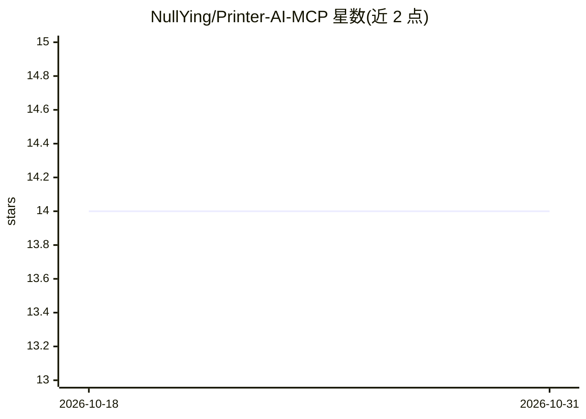

# NullYing/Printer-AI-MCP

⭐ 14 · Python · 推送 2026-03-10 · [GitHub](https://github.com/NullYing/Printer-AI-MCP) · 个人维护 · 中文 README

**跨平台打印机 MCP 服务器：让 AI 助手管理并调用本地打印机**

基于 FastMCP 构建的跨平台（Windows/macOS/Linux）打印机 MCP 服务器，提供 6 类工具：获取打印机列表、状态查询、详细属性（macOS/Linux）、文件打印（多格式）、打印任务状态与取消。Windows 走 DEVMODE 参数，macOS/Linux 依赖 CUPS 使用 IPP 标准选项，API 返回统一 JSON 格式。需 Python 3.10+，通过 uv 或 Docker 部署，接入 MCP 配置后由 AI 助手调用。另提供无服务器进程的 CLI + SKILL.md 替代方案。

## 筛选速览

| 维度 | 判定 | 备注 |
|---|---|---|
| AI 角色 | `ai-ecosystem` | LLM/agent 周边工具 |
| 许可风险 | `none` | — |
| 部署形态 | `self-host` | docker 或自建部署 |
| 模型依赖 | — | README 未给出锁定关系 |
| 硬件要求 | — | 无带数字的原话,不猜 |
| 安装摩擦 | `low` | 无编译、无系统依赖或容器化 |
| 成熟度 | — | 结构信号不足 |

## 能力要点

- 6 个 MCP 工具：打印机列表/状态/属性/打印/任务管理与取消
- 跨平台：Windows DEVMODE 与 macOS/Linux CUPS-IPP 双选项体系
- 基于 FastMCP，接入 MCP 配置即可供 AI 助手调用
- 提供 uv 依赖安装与 Docker Compose 两种部署方式

## 适用场景

- 让 Claude 类 AI 助手直接操作本地打印机打印文件
- 通过对话查询打印机状态与配置属性
- 管理打印任务：查询进度与取消任务

## 场景标签

 · 领域:系统工具/外设集成

## 证据(README 行号)

> L5: A cross-platform printer AI MCP server that supports Windows, macOS, and Linux systems, providing printer management
> L14: - 🚀 **MCP Protocol**: Built on FastMCP, supports AI assistant integration

## 星数曲线

2026-10-18 14 → 2026-10-31 14（+0）

---
*卡片 v1 · prompt 1.4 · 生成 2026-10-31 · 置信度 high · 依据 README sha `7c319200908e` · [字段定义](../../DATASET.md)*
