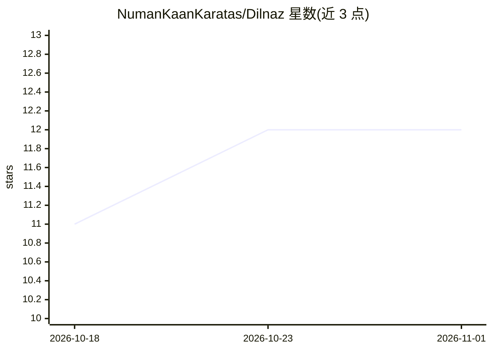

# NumanKaanKaratas/Dilnaz

⭐ 12 · Python · MIT · 推送 2026-10-07 · [GitHub](https://github.com/NumanKaanKaratas/Dilnaz) · 个人维护

**两阶段语义语言建模研究项目：DIL 编码 + NAZ 潜空间生成**

研究状态的两阶段语义语言建模项目：DIL 模型将表层文本映射到归一化连续语义潜空间并可解码回文本，几何受 NLLB 教师监督；NAZ 模型在该语义空间中自回归预测未来潜向量（多步视野），而非直接预测 token id，再由 DIL writer 渲染回表层文本。包含自研混合 tokenizer（字节回退、Turkish 文本往返测试）、SemanticDeltaMixer 与全局注意力交替的骨干、MoE 语义动态混合预测头。以 PyTorch + Python 3.12 实现，从仓库根目录用 python -m 命令训练，支持 PowerShell 一键流水线；checkpoint 不保持向后兼容，旧版本会被拒绝。

## 筛选速览

| 维度 | 判定 | 备注 |
|---|---|---|
| AI 角色 | `ai-native` | 本体是模型或模型工具 |
| 许可风险 | `permissive` | MIT |
| 部署形态 | `None` |  |
| 模型依赖 | — | README 未给出锁定关系 |
| 硬件要求 | — | 无带数字的原话,不猜 |
| 安装摩擦 | `medium` | 含编译或系统依赖之一 |
| 成熟度 | `idea` | |

## 能力要点

- DIL：表层文本 ↔ 归一化语义潜空间（480 维语义 + 32 维表层）
- NAZ：在语义空间预测未来潜向量，支持多步视野同时训练
- 自研混合 tokenizer：字节回退、变长打包、Turkish 往返解码测试
- 语义动态 MoE 混合预测头 + SemanticDeltaMixer/全局注意力交替骨干

## 适用场景

- 研究语义潜空间语言建模范式（潜向量而非 token id 预测）
- 训练并检查 DIL/NAZ 两阶段生成管线
- 复现表层-语义解耦与 writer-only 抛光实验

## 场景标签

`模型训练` · 领域:训练与推理

## 证据(README 行号)

> L10: Dilnaz is a two-stage semantic language modeling research project. The first model, `DIL`, maps surface text into a
> L168: It does not predict token ids. It predicts the next normalized DIL latent, and can train multiple future horizons 

## 星数曲线

2026-10-18 11 → 2026-11-01 12（+1）

---
*卡片 v1 · prompt 1.4 · 生成 2026-11-01 · 置信度 high · 依据 README sha `6e1de7e2ad2b` · [字段定义](../../DATASET.md)*
