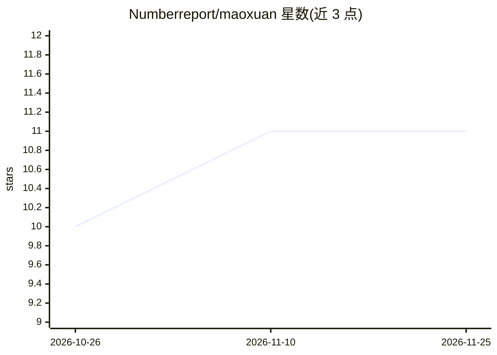

# Numberreport/maoxuan

⭐ 11 · MIT · 推送 2026-05-29 · [GitHub](https://github.com/Numberreport/maoxuan) · 个人维护 · 中文 README

**为 AI 助手提供毛泽东思想六大思维框架的 skill**

面向 Hermes Agent 的 skill 包：SKILL.md 定义矛盾分析法、实践论、阶级分析法、实事求是、群众路线、战略战术六大框架及其核心问题，对话中 AI 自动加载并按分析流程展开。同时收录静火版《毛泽东选集》1-7 卷 242 篇 Markdown 全文，存于 references 目录，来源为 lindaye6 的开源语料仓库。安装方式为 git clone 到 skills 目录，SKILL.md 采用 MIT 许可。

## 筛选速览

| 维度 | 判定 | 备注 |
|---|---|---|
| AI 角色 | `ai-native` | 本体是模型或模型工具 |
| 许可风险 | `permissive` | MIT |
| 部署形态 | `None` |  |
| 模型依赖 | — | README 未给出锁定关系 |
| 硬件要求 | — | 无带数字的原话,不猜 |
| 安装摩擦 | `low` | 无编译、无系统依赖或容器化 |
| 成熟度 | — | 结构信号不足 |

## 能力要点

- 六大核心思维框架，每个对应来源文献与核心问题
- 含静火版毛选 1-7 卷共 242 篇 Markdown 全文
- 对话中自动加载 skill，按框架流程生成分析

## 适用场景

- 让 AI 用矛盾分析法梳理项目或局面的问题
- 向 AI 查询毛选中实践论等相关原文内容
- 用群众路线等框架检验决策是否脱离实际使用者

## 场景标签

`AI 助手` `提示工程` · 领域:Agent 开发

## 证据(README 行号)

> L7: 这是一个为 AI 助手设计的思维框架 skill，提炼了《毛泽东选集》中的核心方法论，让 AI 在面对复杂问题时能够运用矛盾分析、实践论、实事求是等思想工具。
> L41: AI 会自动加载 skill，按照矛盾分析→抓主要矛盾→看转化条件→具体问题具体分析的流程展开。

## 星数曲线

2026-10-26 10 → 2026-11-25 11（+1）

---
*卡片 v1 · prompt 1.4 · 生成 2026-11-19 · 置信度 high · 依据 README sha `6204f755aefb` · [字段定义](../../DATASET.md)*
