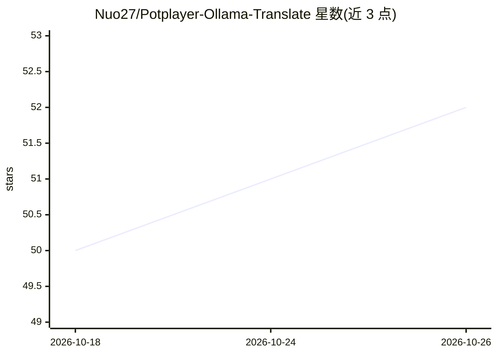

# Nuo27/Potplayer-Ollama-Translate

⭐ 52 · AngelScript · MIT · 推送 2026-09-16 · [GitHub](https://github.com/Nuo27/Potplayer-Ollama-Translate) · 个人维护 · 中文 README

**PotPlayer 字幕实时翻译插件，接 Ollama/自定义 API**

以 AngelScript（.as）扩展形式提供的 PotPlayer 字幕翻译插件：将视频字幕逐句发送至 LLM 服务，获取译文后实时替换显示。支持 Ollama、OpenAI、Anthropic 三种 API 协议，端点与请求参数可在 JSON 配置中自定义，兼容 LM Studio、vLLM、llama.cpp、OpenRouter、DeepSeek 等本地或云端服务。提供上文历史带入、LRU 缓存、失败自动重试、可自定义提示词模板。安装方式为下载 Release 压缩包解压至 PotPlayer 扩展目录，面向使用 PotPlayer 观看外语视频的普通用户。

## 筛选速览

| 维度 | 判定 | 备注 |
|---|---|---|
| AI 角色 | `ai-native` | 本体是模型或模型工具 |
| 许可风险 | `permissive` | MIT |
| 部署形态 | `None` |  |
| 模型依赖 | local-ok | 支持本地模型 |
| 硬件要求 | — | 无带数字的原话,不猜 |
| 安装摩擦 | `low` | 无编译、无系统依赖或容器化 |
| 成熟度 | — | 结构信号不足 |

## 能力要点

- 支持 Ollama / OpenAI / Anthropic 三种 API 协议，端点与请求参数经 JSON 自由定制
- 内存 LRU 缓存翻译历史，重复字幕不重复请求；失败自动重试
- 可带入上文历史（最近 7 句默认）提升翻译连贯性
- 支持 Ollama Cloud、OpenRouter、DeepSeek 等云端及本地推理端点

## 适用场景

- 看外语视频时用本地或云端大模型实时翻译字幕
- 通过自定义提示词与请求参数调整翻译效果
- 配合 LM Studio / vLLM / llama.cpp 等本地服务离线翻译

## 场景标签

`AI 写作` · 领域:内容生成

## 证据(README 行号)

> L3: 这是一个为 Potplayer 开发的插件，可以使用 Ollama 或者其他自定义 API 进行实时字幕翻译。
> L11: - 实时翻译 PotPlayer 字幕。
> L12: - 支持多种 API 协议：Ollama、OpenAI、Anthropic，并通过 JSON 配置自由定制请求参数，详见自定义配置。

## 星数曲线

2026-10-18 50 → 2026-10-26 52（+2）

---
*卡片 v1 · prompt 1.4 · 生成 2026-10-24 · 置信度 high · 依据 README sha `b52c13a541db` · [字段定义](../../DATASET.md)*
