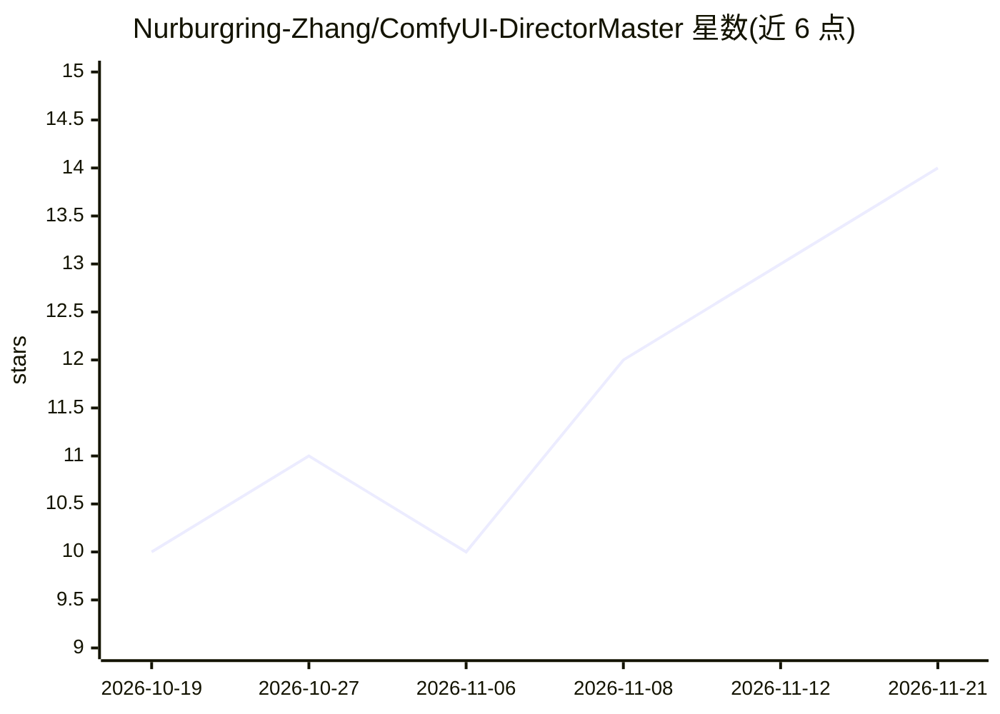

# Nurburgring-Zhang/ComfyUI-DirectorMaster

⭐ 14 · Python · 推送 2026-09-04 · [GitHub](https://github.com/Nurburgring-Zhang/ComfyUI-DirectorMaster) · 个人维护 · 中文 README

**给影视创作者的 ComfyUI 节点包：创意到分镜与视频提示词**

ComfyUI 自定义节点包，将一句话创意经剧本（46 模式）、分镜（63 模式）到 AIGC 视频模型提示词的链路结构化，输出每镜七要素提示词、首帧提示词与音频描述，直供 Seedance/Wan/LTX/Hailuo/Sora 等视频模型。核心机制为 600 位导演风格档案（12–17 维）驱动的确定性模板轨，所有 247 创作模式可在无 LLM 端点时运行；可选接入 OpenAI 兼容端点做润色，含质量门控与降级状态机。零第三方依赖，以 git clone 装入 ComfyUI custom_nodes 目录运行，含 doctor.py 自检与测试套件。

## 筛选速览

| 维度 | 判定 | 备注 |
|---|---|---|
| AI 角色 | `ai-native` | 本体是模型或模型工具 |
| 许可风险 | `none` | — |
| 部署形态 | `None` |  |
| 模型依赖 | local-ok | 支持本地模型 |
| 硬件要求 | — | 无带数字的原话,不猜 |
| 安装摩擦 | `low` | 无编译、无系统依赖或容器化 |
| 成熟度 | — | 结构信号不足 |

## 能力要点

- 600 位导演 12–17 维风格档案驱动的剧本与分镜生成
- 每镜七要素提示词注入分镜 JSON 与交付 JSON，适配 Seedance/Wan 等格式
- 可选 OpenAI 兼容端点润色，无端点时走确定性模板轨
- 写盘归档版本控制（blob 去重 + gzip）与回滚逐字节还原

## 适用场景

- 把一个创意变成可直接投喂视频生成模型的分镜提示词
- 按选定导演风格生成剧本与分镜方案
- 长篇小说切分为分集制作数据包
- 短视频/动漫/广告等 24 种形态的场次结构编排

## 场景标签

`提示工程` `视频生成` `图像生成` · 领域:Agent 开发

## 证据(README 行号)

> L3: **导演级 AI 影视创作 ComfyUI 节点包** — 一句话创意 → 剧本 → 分镜 → AIGC 镜头级提示词，直供 Seedance / Wan / LTX / Hailuo / Sora 等主流视频生成模型。
> L23: - 🧠 **AI 增强轨**：任意节点可接 OpenAI 兼容端点做剧本/分镜润色，内置质量门控（长度门 / 照抄检测 / 反 AI 套话扫描 / SSRF 防护），无端点时自动走确定性模板轨。V16.2.0 起增加 LLM 链路

## 星数曲线

2026-10-19 10 → 2026-11-21 14（+4）

---
*卡片 v1 · prompt 1.4 · 生成 2026-11-18 · 置信度 high · 依据 README sha `f114ef1a5d20` · [字段定义](../../DATASET.md)*
