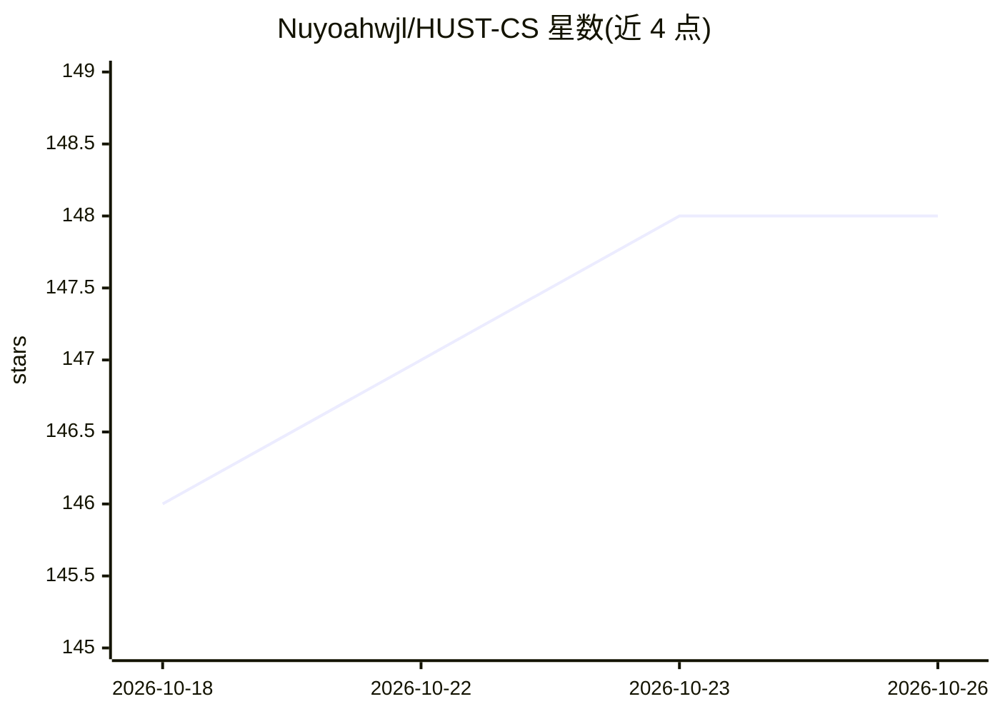

# Nuyoahwjl/HUST-CS

⭐ 148 · Jupyter Notebook · MIT · 推送 2026-06-29 · [GitHub](https://github.com/Nuyoahwjl/HUST-CS) · [官网](https://1037.wiki) · 个人维护 · 中文 README

**华中科技大学计算机学院本科课程资料存档仓库**

个人维护的 HUST 计算机学院 23 级课程学习资料合集，收录 C 语言、数据结构、计算机组成原理、操作系统、编译原理、机器学习、深度学习、计算机视觉等数十门课程的学习笔记、代码、实验报告与课件。属于高校课程知识聚合类仓库，通过 git clone 或 GitZip 下载获取本地副本。README 中附有 DeepSeek 问答链接作为学习咨询入口。

## 筛选速览

| 维度 | 判定 | 备注 |
|---|---|---|
| AI 角色 | `ai-knowledge` | 知识聚合/清单类 |
| 许可风险 | `permissive` | MIT |
| 部署形态 | `None` |  |
| 模型依赖 | — | README 未给出锁定关系 |
| 硬件要求 | — | 无带数字的原话,不猜 |
| 安装摩擦 | `low` | 无编译、无系统依赖或容器化 |
| 成熟度 | — | 结构信号不足 |

## 能力要点

- 覆盖数十门计算机本科课程的学习资料
- 内容形式包括笔记、代码、实验报告与课件
- 支持 git clone 整体下载或 GitZip 按目录下载

## 适用场景

- HUST 计算机学院学生对照课程大纲查找学习资料
- 备考与实验作业参考他人笔记和代码
- 自学者按课程体系浏览计算机本科知识结构

## 场景标签

`教程课程` · 领域:学习与行业

## 证据(README 行号)

> L2:  🏆 Course archive: notes, code, lab reports, courseware, etc 🏆

## 星数曲线

2026-10-18 146 → 2026-10-26 148（+2）

---
*卡片 v1 · prompt 1.4 · 生成 2026-10-22 · 置信度 high · 依据 README sha `41a1d0aea62b` · [字段定义](../../DATASET.md)*
